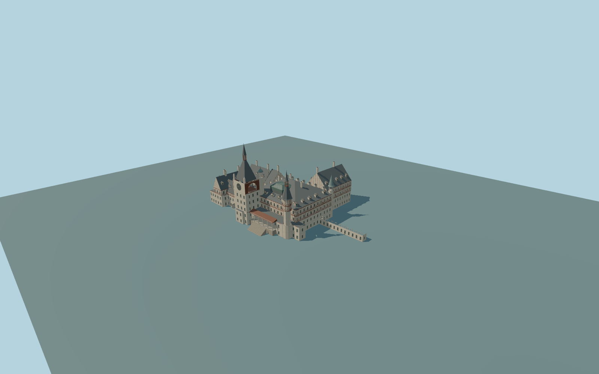

# Peleș Castle

Complete principal Peleș Castle exterior, including both mapped parents, all connected main and returned ranges around the actual western courtyard, the square clock tower with open gallery arches and closed clock panels, its steep roof and open lantern/spire, the polygonal half-timber front tower, two separate white turrets, slate gables and hips, closed dormers, chimneys, a closed central glass roof with fitted curb, the front veranda, through-gateway and low eastern retaining gallery. Original simplified timber and stone trim; figurative murals, sculpture, inscriptions, heraldry and interiors are excluded. Independent estate buildings, gardens and forest remain native context.

Rebuild: `node packages/worldgen/scripts/generate-peles-castle.mjs`;append `--check` for exact source bytes. Select import/LOD/placement with `--ids=peles_castle`. Detailed source and four browser tiers are separate ignored GLB outputs.

Complete principal Peleș Castle exterior, including both mapped parents, all connected main and returned ranges around the actual western courtyard, the square clock tower with open gallery arches and closed clock panels, its steep roof and open lantern/spire, the polygonal half-timber front tower, two separate white turrets, slate gables and hips, closed dormers, chimneys, a closed central glass roof with fitted curb, the front veranda, through-gateway and low eastern retaining gallery. Original simplified timber and stone trim; figurative murals, sculpture, inscriptions, heraldry and interiors are excluded. Independent estate buildings, gardens and forest remain native context.

Approximate standard global DEM datum 928 m; common principal floor 925.8 m and raised veranda floor 928.8 m. Current PMTiles 3D parts guide massing; inspected pictures guide roof rises, lanterns and spires where mapped roof metadata is incomplete. Clock roof reaches 39 m and finial 49 m above the common floor. One unchanged global Terrarium tile supplies the hillside field. Buried occupied plinths and three bounded supported approaches adapt the approximate grades. The actual western courtyard and gateway stay open.

Three ordinary front, court-corner and oblique aerial pictures were inspected. Rear and roof inventories, concealed joins, original clock and gable trim, window rhythm, timber patterns, terrace shapes and historic grades are medium-fi approximations. Lower garden works and independent estate structures are outside the principal-building scope. Context is synthetic; physical device timings and numerical LOD errors remain unmeasured.

Seven existing shared 256px plaster, limestone, granite, wood, slate, copper and window-grid graphs; metric UVs, linear colors and no private or embedded images. Four separately authored browser tiers retain the complete mapped composition. Skyline simplifies small contours, lantern posts and approaches; district uses window proxies and timber bands; street uses closed recesses; close-up adds timber braces and roof trim; the detailed master preserves finer framing.

Original geometry:repository license. Map:© OpenStreetMap contributors,ODbL-1.0;Protomaps. Standard terrain:terrain-grid.json. Ordinary pictures stay local and are not redistributed or used as textures. Current acceptance:qa.json.
