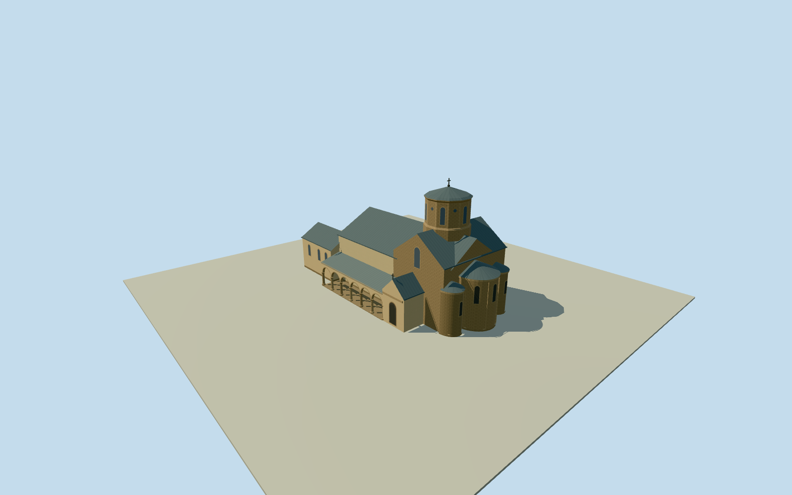

# Armenian Cathedral of Lviv

Low polygonal metal cupola, dressed stone apses and open southern courtyard arcade of Lviv’s Armenian Cathedral.

Authoring state: **review-in-qa.json**. Current completion evidence is in [qa.json](qa.json) and the [completion ledger](../../../../qualla-structures/batches/qualla-003.PROGRESS.md).

- [Armenian Cathedral of Lviv](https://qualla.com/armenian-cathedral-of-lviv/)

Exterior represents the May 2016 photographs. Distances from the mapped perimeter set scale and orientation. The footprint generalizes the east apses.

Roof junctions, northern and western elevations, attached range subdivisions, stone courses and unmeasured heights are approximate. Fine carving, inscriptions and interior art are omitted.

The independently mapped belfry and other courtyard buildings are outside the cathedral scope.

A preserved original elevation field supplies placement. Thresholds and foundations are representative rather than surveyed.

Cleared exterior photographs remain in the local story corpus. The recipe uses its own geometry and shared materials.

Build: `node content/worldgen/source/places/u8/u8c/armenian_cathedral_of_lviv/models/generate-cathedral.mjs`. Add `--check` to verify exact regeneration. 2912 triangles; 5 materials; no embedded photographs.
