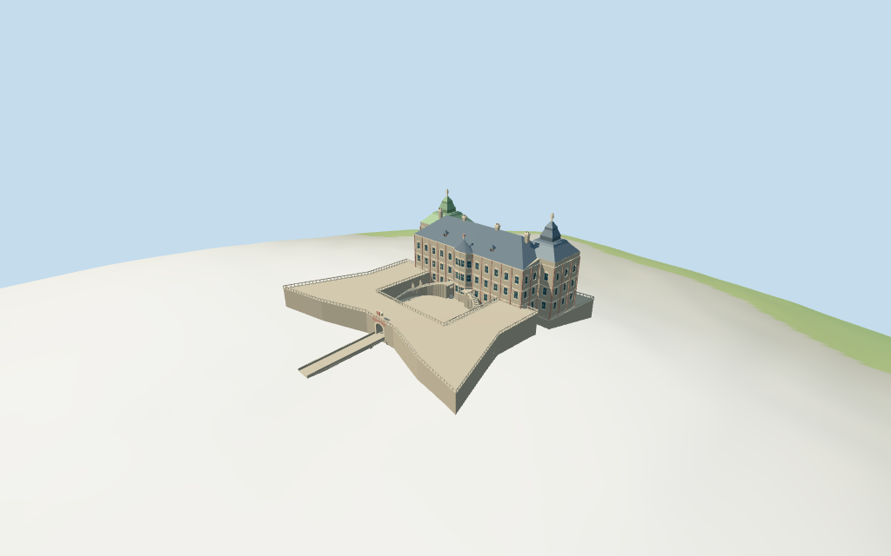

# Pidhirtsi Castle

Individual pale/rose palace: mapped twin pavilion/body plan, west green/east gray tiered roofs and finials, broad steep main roof, projecting central bays, framed windows, opposing stair arms, north belvederes and U-shaped lower fortified wings with open gate/arcades and south causeway.

## Evidence and reconstruction

Published dimensions and reconstructed details are separated in spec.json. Primary references:

- [Reference](https://commons.wikimedia.org/wiki/File:%D0%9F%D1%96%D0%B4%D0%B3%D0%BE%D1%80%D0%B5%D1%86%D1%8C%D0%BA%D0%B8%D0%B9_%D0%B7%D0%B0%D0%BC%D0%BE%D0%BA%2C_%D0%B0%D0%B5%D1%80%D0%BE%D1%84%D0%BE%D1%82%D0%BE.jpg)
- [Reference](https://desadmi.com/ua/ukraina/1931-zolota-pidkova-lvivshchyny)

Four existing256-square graphs supply lime plaster, weathered limestone, slate and painted metal with linear tints and metric UVs. Glass uses a vertex-colored palette. No unique photographed facade, bitmap or embedded image.

## Model and axes

16,626 triangles; 49,878 vertices; 5 material groups; 1,998,416 bytes. Native bounds: -44.188, -5.749, -24.199 to 44.188, 38.800, 78.000. Source hash: `sha256:404cf32dec93639d4c10af4905fcd0a86d9c6a04d6a3fe5d7a708b106894297d`.

{"x":"east along palace","y":"up","z":"south toward courtyard and gate"}

Two inspected north/south aerial photographs and standard viewer PMTiles/DEM guide the palace exterior. Main outline is mapped; fortification/bastion layouts, levels, stairs, roofs and reliefs are exterior interpretations. Separate church, estate, trees and town remain host content. © OpenStreetMap contributors, ODbL-1.0.

## Reproduce

Run `node packages/worldgen/scripts/generate-additional-landmarks.mjs --ids=N0324` (or add `--check`). The generator preserves manually edited masters by checking their baseline hashes. Import through the standard authored-model workflow with optimization disabled; then capture all QA cameras, including shared-surface views.

## Pending work

- Main palace outline retains exact mapped identity and current polygon control; outer wings/bastions, untagged heights, stair curves, cupolas and damaged ornament are picture-led exterior estimates.
- NativeY0 follows coarse standardDEM387.1541m. Court/palace floor3.5m, foundations, belvederes, causeway levels, dry-moat attachment and terrain joins are approximate; no bare-earth/moat survey or certified walking collision.
- Skyline preserves roofs, body, gate/courtyard and belvederes, omitting windows/stair/rail detail. District uses sparse surface windows and simpler tiers; street/closeup add recessed glazing, frames, cornices, chimneys, arcade reveals, stair treads and sparse balusters. Full interiors and exact facade/sculpture/weathering reconstruction are excluded.
- The bridge-like approach follows an untagged mapped footway and the inspected picture; no bridge-specific road suppression is claimed. Separate church, estate, garden buildings, town, vegetation, visitors and current condition survey remain host responsibilities.
- Physical laptop and phone performance measurements remain pending.

This bundle follows the medium-fi standard. Medium-fi appearance and geographic fit are reviewed separately. Hash-bound visual acceptance is recorded separately after capture inspection.

## Additional geographic data

© OpenStreetMap contributors; Protomaps; Mapzen/USGS terrain tiles.
