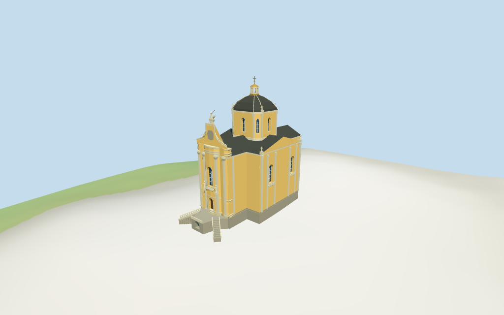

# Saint George's Cathedral

Individual medium-fi cathedral exterior:full mapped cross plan,yellow plaster/pale Baroque trim,bowed west facade with single recessed door and tall arched window,curved gable and selected faceted sculptural silhouettes,split entry stairs with central recessed grotto,central chamfered drum/dark dome/gold lantern and cross,lower nave/transverse metal roofs and selected side openings. Separate palace/courtyard wings,gates,belltower,sculpture accuracy,full interiors and certified walking excluded.

## Evidence and reconstruction

Published dimensions and reconstructed details are separated in spec.json. Primary references:

- [Reference](https://lviv.travel/ua/news/arkhitektura-baroko-u-lvovi)
- [Reference](https://find-way.com.ua/oblast/lvivska/lviv/sobor-sviatoho-yura-lviv)
- [Reference](https://www.lonelyplanet.com/ukraine/western-ukraine/lviv/attractions)

Five existing256-square graphs:lime plaster,raw/weathered limestone,standing-seam metal and wood. Dark roof/gold lantern share the metal graph with linear vertex tints. Metric UVs,flat architecture normals and flat glazing;no embedded images.

## Model and axes

10,368 triangles; 31,104 vertices; 7 material groups; 1,248,464 bytes. Native bounds: -28.903, -1.223, -12.605 to 21.188, 45.900, 12.605. Source hash: `sha256:df5d3b87e14964530ae727fcf3bbb7f7f9f5a4ca4ea49aa5bd70fe089f452f11`.

{"x":"east toward rear sanctuary","y":"up","z":"south toward transverse projection"}

Standard DEM datum 316.656407m;estimated church floor 3.9m includes a raised entry platform above sampled footprint peak 1.228m and perimeter -0.87..1.23m. Foundation and lower stair approach follow coarse terrain. Precise court/stair thresholds and heights are picture-led approximations;no survey or certified walking.

## Reproduce

Run `node packages/worldgen/scripts/generate-additional-landmarks.mjs --ids=N0344` (or add `--check`). The generator preserves manually edited masters by checking their baseline hashes. Import through the standard authored-model workflow with optimization disabled; then capture all QA cameras, including shared-surface views.

## Pending work

- Current exact-QID parent supplies the approximately 42x24m cross plan, but its 5m height is clearly inconsistent with all inspected photographs and is rejected as an architectural height. All vertical stages are approximate picture proportions: 19.5m eave,23m nave ridge,23..31m central drum,35.8m dome crown,39.4m lantern and42m cross top above the estimated church floor;front cornice22m,curved gable28.5m and selected equestrian silhouette32.5m. No independent measured vertical dimensions.
- Standard DEM datum 316.656407m;estimated church floor 3.9m includes a raised entry platform above sampled footprint peak 1.228m and perimeter -0.87..1.23m. Foundation and lower stair approach follow coarse terrain. Precise court/stair thresholds and heights are picture-led approximations;no survey or certified walking.
- Individual exterior approximation from three inspected pictures and standard map/terrain. Exact coat-of-arms reliefs,equestrian/standing sculptures,side/rear decoration,full interiors,separate palace/courtyard wings,gates and belltower excluded. Split stairs/grotto are approximate;physical phone/laptop measurements pending.
- Skyline retains cross plan,bowed facade,curved gable,central drum/dark dome,gold lantern/cross and coarse split stair mass. District adds shared textures,recessed closed door/front and side glazing,selected facade figures and balcony. Street adds recessed drum glazing,open lantern,bands/ribs,pilasters and stair balustrades;closeup refines arch/figure/stair details. Detail transitions remain visible.

This bundle follows the medium-fi standard. Medium-fi appearance and geographic fit are reviewed separately. Hash-bound visual acceptance is recorded separately after capture inspection.

## Additional geographic data

©OpenStreetMap contributors;Protomaps;Mapzen/USGS terrain tiles.
