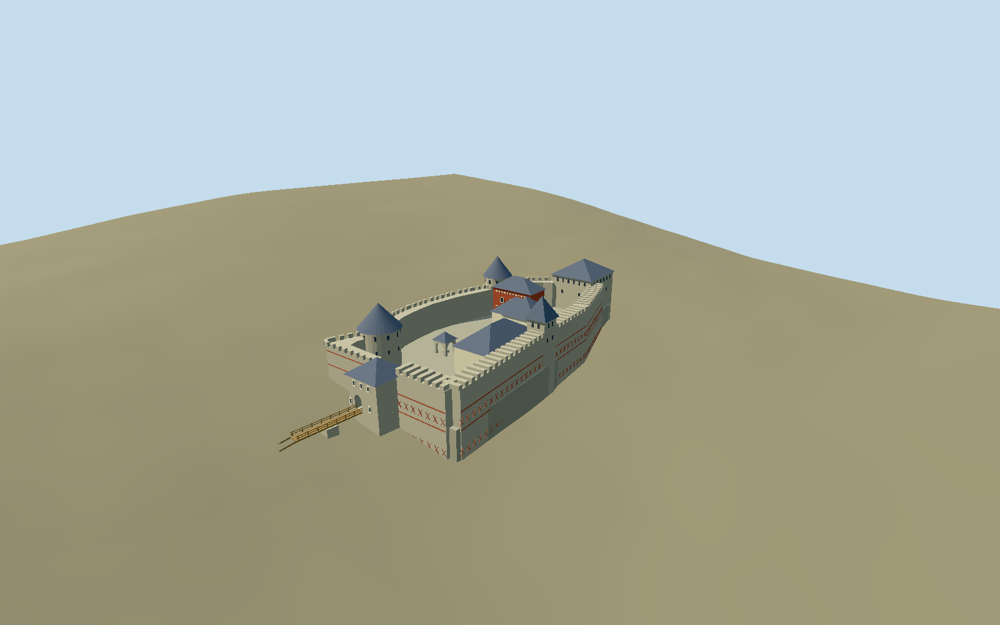

# Khotyn Fortress

Five-tower inner citadel with tall curved stone walls, red-brick geometric bands, shingled roofs, open courtyard, palace, chapel, well and wooden entrance bridge. The surrounding Ottoman earthworks are outside this model.

## Evidence and reconstruction

Published dimensions and reconstructed details are separated in spec.json. Primary references:

- [Reference](https://khotynska-fortecya.cv.ua/mapa_forteci)
- [Reference](https://khotynska-fortecya.cv.ua/istoriya-khotynskoyi-fortetsi-en)
- [Reference](https://www.openstreetmap.org/relation/8520372)

No third-party geometry, photograph or bitmap texture is embedded. Shared surface graphs come from the central library; vertex tints carry model colors. Glazing uses PBR materials; transparent surfaces are declared per model.

## Model and axes

8,578 triangles; 17,846 vertices; 5 material groups; 748,648 bytes. Native bounds: -35.377, -9.539, -75.189 to 29.205, 34.461, 95.177. Source hash: `sha256:afe6886547cdfc71acd06a77cfbbf5ee0423f75ceef7ebfe6e79816a9c868121`.

{"up":"+Y","longitudinal":"+Z south-southeast entrance164.768065 degrees","front":"+Z entrance bridge","origin":"Fresh north/gate centroid midpoint; Y0 decoded126.3247 m working datum."}

Fresh exact-QID relation8520372 v24 identifies the wider fortress, not this inner-citadel model. Named north/gate/west/southwest/east tower, palace, chapel, barracks, well and western curtain plans are retained separately; no false exact-QID tag on each component. Revised anchor[26.498528407744324,48.52213188288293] and heading0.2658474118833337 align north/gate centroid axis: +X east-northeast74.768065 degrees, +Z south-southeast164.768065 degrees toward entry. River/barracks +X, west towers/palace -X, north keep -Z. Main river-curtain connections and convex court envelope are reconstructed from component plans and reserve diagram, not an extracted exact fortress polygon. Original schematic frame retained in sourceFacts, original master unchanged. Retained16641-value4 m terrain grid uses decoded datum126.3247 m;3.164162 m pixel interval is not verified native resolution/survey accuracy. Maximum occupied court-envelope sample plus0.25 m selects rigid court8.4609 m/common architecture shift-15.5391 m. Foundation floor-5.6185 m is buried; bounded court masonry plinth leaves host terrain outside and under bridge. No whole-fortress/city/river terrain replacement. Datum/vintage and building contamination unverified.

## Reproduce

Run `node packages/worldgen/scripts/generate-signature-towers.mjs --ids=khotyn_fortress` (or add `--check`). The generator preserves manually edited masters by checking their baseline hashes. Import through the standard authored-model workflow with optimization disabled; then capture all QA cameras, including shared-surface views.

## Pending work

- Original8615-triangle/740964-byte master reproduces at sha256:1ee9d2ca9c81ab2bdf617202b1e5458b64c6332a189e1478f4a27ad656e55e69 from unchanged khotyn-fortress-model.mjs#khotynStudy.build.
- Fresh exact-QID relation8520372 v24 identifies the wider fortress, not this inner-citadel model. Named north/gate/west/southwest/east tower, palace, chapel, barracks, well and western curtain plans are retained separately; no false exact-QID tag on each component. Revised anchor[26.498528407744324,48.52213188288293] and heading0.2658474118833337 align north/gate centroid axis: +X east-northeast74.768065 degrees, +Z south-southeast164.768065 degrees toward entry. River/barracks +X, west towers/palace -X, north keep -Z. Main river-curtain connections and convex court envelope are reconstructed from component plans and reserve diagram, not an extracted exact fortress polygon. Original schematic frame retained in sourceFacts, original master unchanged. Retained16641-value4 m terrain grid uses decoded datum126.3247 m;3.164162 m pixel interval is not verified native resolution/survey accuracy. Maximum occupied court-envelope sample plus0.25 m selects rigid court8.4609 m/common architecture shift-15.5391 m. Foundation floor-5.6185 m is buried; bounded court masonry plinth leaves host terrain outside and under bridge. No whole-fortress/city/river terrain replacement. Datum/vintage and building contamination unverified.
- Four-meter diagnostic grid resamples coarse public terrain;3.164162 m pixel interval is not verified native resolution or survey accuracy. Datum/vintage/under-building contamination unknown; no outlier filter.
- Maximum occupied reconstructed court envelope sample plus0.25 m sets the rigid court floor; buried foundations extend two meters below minimum envelope sample. Component heights use courtyard datum, not the reserve external rock-base measurements. This is not a measured court or river-bank profile.
- Host ground remains outside the bounded court/plinth and beneath the bridge; no whole fortress/city/river terrain replacement. River-wall joins and exact rock foundations are interpreted from mapped component plans and primary photographs.
- Individual fresh component footprints define locations and reconstructed wall envelopes; no surveyed vertical levels. Published interior and external component plan dimensions differ from mapped roof/base envelopes.
- Accepted medium-fi conserved five-tower inner citadel: curved western stone curtains, reconstructed river-wall connections, red geometric brick bands, dark shingle roofs, roofless court, west checker-brick palace/open veranda, east barracks/chapel with paired west windows, open well pavilion and mapped timber entrance bridge. Distinct component locations replace original schematic spacing. Individual roof/base envelopes approximate current mapped footprints; published component dimensions sometimes describe internal dimensions. Gate12.8 m reconstructed exterior differs from published7.73×10.35 m internal description; west tower5 m published diameter is ambiguous and retained outer mapped estimate is11.4 m. North roof rise/profile is interpreted, not the rock-base68 m datum.
- Precise wall/rock heights, connection joints, courtyard subdivisions, ramp/stair positions, conservation stains, fine grille/cusp patterns, windvanes/crosses, door panels/interiors,50 m well shaft, archaeology and collision/navigation excluded or abstracted. Current exterior interpretation without exact2026 daily-condition survey. Snow and temporary exhibits/railings excluded. Original outer-wall earthworks, moat beyond entrance, barbacan, river water and outer church outside scoped model. No claim every listed reserve structure is modeled.
- Four common graphs provide limestone, brick, cedar shingles and plain wood. One opaque local recess group supplies dark windows. Skyline bakes measured common linear means. No embedded images; physical laptop/phone timings pending.
- Convex interior court envelope includes the mapped southeast curtain connecting the eastern wall to the gate. It is reconstructed, not an exact archaeological court plan. Outer barbican and earthworks are excluded. The small court-service-block footprint is not the missing river curtain; it is retained as source context without an authored service building.

This bundle follows the medium-fi standard. Medium-fi appearance and geographic fit are reviewed separately. Hash-bound visual acceptance is recorded separately after capture inspection.

## Additional geographic data

Map identity © OpenStreetMap contributors, ODbL-1.0. Reserve images are linked references, not redistributed textures or geometry.
