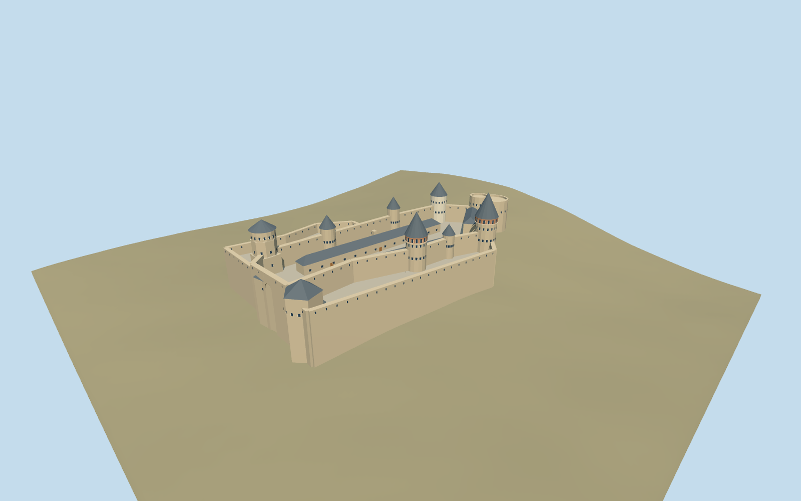

# Kamianets-Podilskyi Castle

Kamianets Old Castle:irregular open court,faceted Papal southeast tower with broad cap,two tall conical northern towers with warm arched crowns,pentagonal New East gate corner,open paired western bastion and lower outer courts with low casemate roofs.

## Evidence and reconstruction

Published dimensions and reconstructed details are separated in spec.json. Primary references:

- [Reference](https://tovtry.com/ua/history/secinski/zamki/text_full.html)
- [Reference](https://kam-pod.gov.ua/turistu/item/159-turystychni-marshruty)
- [Reference](https://kamianets.travel/en/location/starii-zamok-kamianec-podilskii)
- [Reference](https://niazkamenec.org.ua/bezbaryernyst-pamyatok/355-meta-bezbaryernyst-pamyatok.html)
- [Reference](https://www.openstreetmap.org/way/274749273)

No third-party geometry, photograph or bitmap texture is embedded. Shared surface graphs come from the central library; vertex tints carry model colors. Glazing uses PBR materials; transparent surfaces are declared per model.

## Model and axes

4,182 triangles; 12,546 vertices; 6 material groups; 505,556 bytes. Native bounds: -91.900, -11.932, -62.491 to 96.732, 46.000, 50.586. Source hash: `sha256:0ee9e78fa6f41e462ff89dfd3b9066f07572e98b01aeaf567d52a19ffe5d8229`.

{"up":"+Y","longitudinal":"+X toward northwest end / New West tower; -X toward southeast entry and Papal tower","front":"Northern cone towers and lower gate court at+Z;Papal/southern chain at-Z","origin":"Site anchor; Y0 standard PMTiles working datum."}

The inspected aerial picture confirms the asymmetric Old Castle tower chain, two tall northern cones with warm crown bands, broad Papal cap, paired open western bastion and lower outer courts. Standard viewer PMTiles and the retained site frame establish approximate reference-anchor placement and northwest/southeast sign. The parent map ring is a broad compound boundary, not an exact tower footprint. A reconstructed11m working court clears coarse western ground; bounded walls/towers extend below sampled terrain. Individual tower centers and elevations remain approximate. Anchor 26.5625,48.67333333; heading 2.356194490192345; standard PMTiles datum 172.23851829222582m. Floors are reconstructed and foundations extend below the coarse sampled ground.

## Reproduce

Run `node packages/worldgen/scripts/generate-signature-towers.mjs --ids=N0278` (or add `--check`). The generator preserves manually edited masters by checking their baseline hashes. Import through the standard authored-model workflow with optimization disabled; then capture all QA cameras, including shared-surface views.

## Pending work

- Approximate current Old Castle exterior from inspected picture and standard viewer PMTiles; no bespoke survey or exact thresholds.
- Original architectural recipe/master preserved; independent derivative fits the working court and bounded foundation bottoms.
- Asymmetric towers, pointed northern roofs, warm crown bands, broad Papal cap, open western bastion, gate corner and outer courts retain identity. Dimensions and tower positions reconstructed.
- Reference anchor and axis are approximate; whole-site outline does not validate individual tower registration. Footprint replacement remains off.
- Separate New Castle earthworks, river-level Water tower, canyon, city bridge, removed gates and interiors excluded. Outer court elevations simplified.
- Five common material graphs and local opaque glass; no embedded images. Physical-device timing pending.

This bundle follows the medium-fi standard. Medium-fi appearance and geographic fit are reviewed separately. Hash-bound visual acceptance is recorded separately after capture inspection.

## Additional geographic data

© OpenStreetMap contributors. Original Sitsinsky survey hosted by Podilski Tovtry National Nature Park;Kamianets City Council,municipal tourism and National Architectural Reserve primary references.
