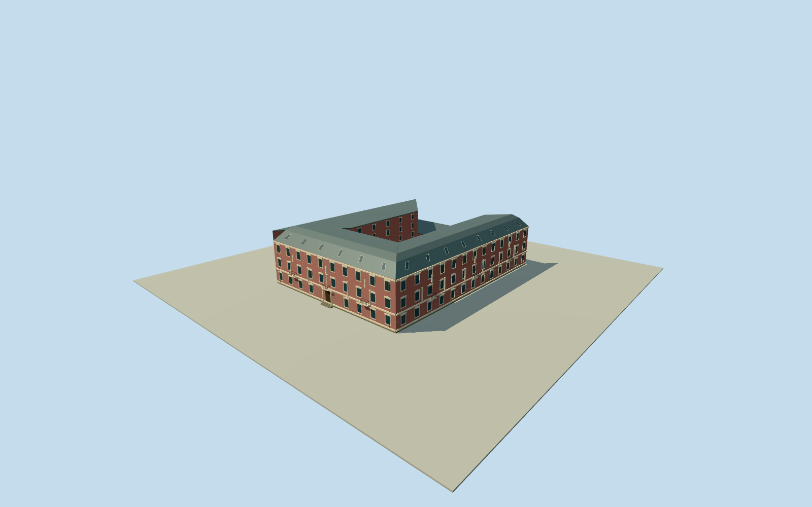

# Bristol Hotel, Odesa — restored historical hotel

Whole restored BristolHotelOdesa physical building, allstreet/courtyardwings andintrinsiccourtyardannex/hall/accommodation/roofvolumes, actualopeninnercourtyard, fourstoreyincludingmansard/slopingatticroofskylights, balconies and definingwhitemarblecolumns/Neoclassicalstatuary/BaroqueRenaissanceornament. Primaryrestorationarchitectfirstpersonaccount andownerwrittenrestoration/atticfacts; userownedQuallastoryarchitecture/phasefacts. Whole original numericz15relation5758628outerringandactualcourtyardhole/pairednamedBristolPOI/Q4096565, quantizednotnativeOSMnodesurvey; currentfootprintapproxhistoricalregistration. All preciseheights/roof/wingdivisions/census/ornament/paint/grade estimates. Dated2014intactbuilding;2025damage acknowledged, no currentreplacement, independentneighbors/Philharmonic/Bank/interiors excluded.

Authoring state: **review-in-qa.json**. Current completion evidence is in [qa.json](qa.json) and the [completion ledger](../../../../qualla-structures/batches/qualla-002.PROGRESS.md).

- [Bristol Hotel, Odesa](https://qualla.com/bristol-hotel-odesa/)

Whole restored BristolHotelOdesa physical building, allstreet/courtyardwings andintrinsiccourtyardannex/hall/accommodation/roofvolumes, actualopeninnercourtyard, fourstoreyincludingmansard/slopingatticroofskylights, balconies and definingwhitemarblecolumns/Neoclassicalstatuary/BaroqueRenaissanceornament. Primaryrestorationarchitectfirstpersonaccount andownerwrittenrestoration/atticfacts; userownedQuallastoryarchitecture/phasefacts. Whole original numericz15relation5758628outerringandactualcourtyardhole/pairednamedBristolPOI/Q4096565, quantizednotnativeOSMnodesurvey; currentfootprintapproxhistoricalregistration. All preciseheights/roof/wingdivisions/census/ornament/paint/grade estimates. Dated2014intactbuilding;2025damage acknowledged, no currentreplacement, independentneighbors/Philharmonic/Bank/interiors excluded.

PrimaryrestorationarchitectNataliaMerzhievska firstperson21June2011interview, preservedascurrentHTTP200publishedversion: historicfacade/mouldings restored/copperdrainage; newcourtyardhall/conference/technicalbuilding; onecourtyardwing gainedfourstoreys. Original2011bytes/architectdrawings not retrieved. Ownerwrittenroomdescription fixesfourth-floorattic/skylights andstreet/courtyard-facing balconies; ownerreopening15December2010. User-ownedQuallawrittenstory supplieswhitecolumns/Neoclassicalstatuary/RenaissanceBaroquearchitecture and2025damagephase. No sourcephoto/plan/figure adopted.

Original numericz15relation5758628four-controlouterringandactualfour-controlcourtyardhole retained exactly, pairednamedBristolPOI/Q4096565. Quantizedcurrentmap is approximate2014registration, not surveyed2014outline or undamagedcurrentroof. Actualcourtyardstaysopen atallLODs; completefourconnectedwings/streetfacades/courtfronts/roofs retained. IndependentPhilharmonic/Bank/neighbors/interiors excluded, no facade/siteproxy.

All exactwing-height/plan-sectionassignments estimated: twoheritageLstreetwings atnativeedges0/3, rearleftcourtyardaccommodationatnativeedge1 andcourtyardhallatnativeedge2. Connect originaloutercorners tocorrespondingoriginalholecorners todefinewholeattachedbandplans; source doesnotgive measuredcomponentboundaries/roofplans. Theirassignment carriesnominal10mregistrationuncertainty; do not call these measured2010wingplans.

Estimated providerrelativefloor0.45m/basementbottom-3.05m, oldstreetmain3x4.2mstoreys plusfourthmansardattic; walltop13.05m/lowerroofbreak15.95m/upperridge17.15m. Mansardroofprofile/pitch/cornerjunction/eaves/insets/skylightcensus are estimates fromdocumentedattic/skylights only. No guessedOperaTheatre dome or unrelatedroofpavilion. Streetmainheightuncertainty2m/roofrise1m.

Estimated moderncourtyardwingoneexistingfloor+fouradded=5levels of3.05m, top15.7m plus0.25mflatcap; assumptionofoneoriginalfloor expresslyestimated. Estimatedcourtyardhall2levels3.7m, top7.85m plus0.25mflatcap. Actualhall/accommodationheight/roofdetails unknown; nominal2.5mheightuncertainty. Wholeouterandinnerenvelope includesbothwings, not omittedcourtyardannexes.

All facadebay/door/window/balcony/column/statuary/cornice/frieze/medallion/bracket/rusticationcensus/proportions/ornamentpositions estimated. Pastelrose/ivorypaint, metalroof/drainfinish, glass/wood andcopperfittings approximate, not source-pixelmatched. Neoclassicalfigures are newabstractoriginalhuman-shapedornament withnosemanticface/historicalartworktrace; no facsimilestatue/calligraphy/graphic claim. Whole streetfronts andallcourtyard/rearfaces retained.

Original128m/16641height independentfield/singlerawtile, datum44.4001m, acquired before all floors/mainsections. Sourcefieldrelative-10.23..3.08m retained unchanged; building/canopy/DEMoffsets not historicgroundsurvey. Preserve frame/field/floors/mainsections duringreview; no cutout/flatten/mask/refetch/refit for pictures. Groundcontact/geographicverticalregistration approximate/unverified.

Dated2014intactrestoredhistoricalhotel only. User-ownedstoryreports31January2025missiledamage; never implymodelroofmatchesundamaged2026conditions orautoactivatecurrentworld. No newsourcephotographs oroldpostcards adopted; unknownrightssources skippedwithoutquestion/rightsrepair. Qualla-first36families, everyimage/figure/video/drawingunused.

Build: `node content/worldgen/source/places/u8/u8m/bristol_hotel_odesa/models/generate-house.mjs`. Add `--check` to verify exact regeneration. 27337 triangles; 6 materials; no embedded photographs.
