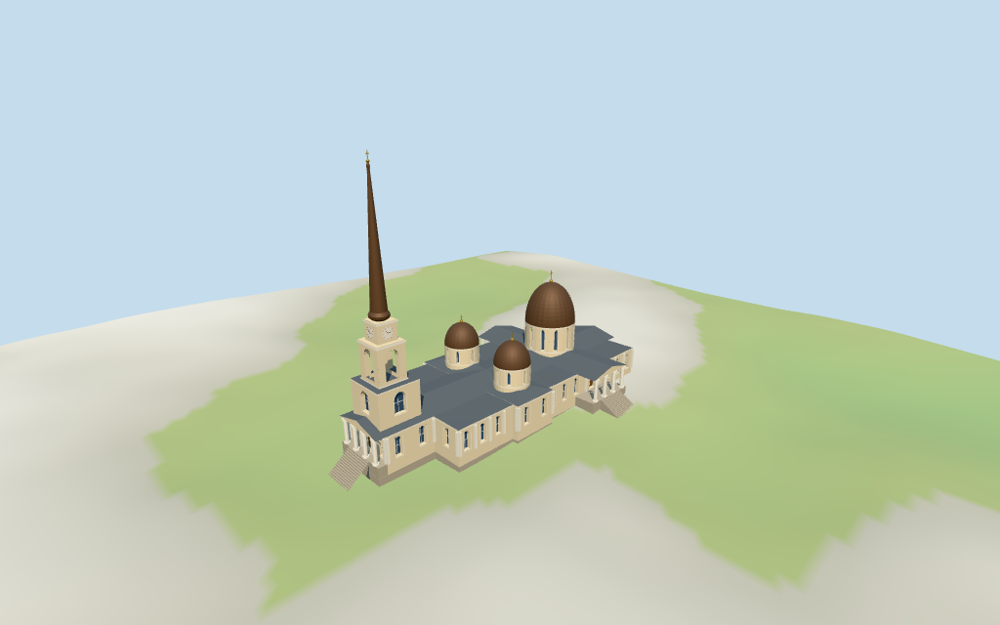

# N0359 — Transfiguration Cathedral review

Reviewed 2026-10-15 against current source/runtime bytes. Accepted for this medium-fi exterior and approximate geographic/terrain scope.

## Built result

Inspected all 11 current portable/source-terrain frames. Individual Odesa cathedral with cream/white classical facades, low gray cruciform roofs, large eastern dome on an arched-window drum and two smaller western domes. The tall western tower has a closed lower windowed stage, truly open upper arched belfry, four clock faces, bronze-brown bulb and tall needle with restrained gold finial/cross. Four open columned porticoes, closed wood entries, raised podiums, stairs, sparse mullions, pilasters and cornices establish the exterior. Corrected inward dome/needle winding, closed the missing low-wing roof caps, removed a window overlapping the west wood door and lowered the common basement base from 3.53m to 0.5m. The 3m raised entry plane remains. Detailed facade/drum apertures have closed glass backing; porch and upper belfry gaps are open. No full interiors, sculpture, icons or lettering.

Medium-fi exterior based on one inspected 2025 tree-obscured street picture, one older 2021 aerial and standard viewer PMTiles/DEM. Dome caps, needle above37m, wall/eave divisions, western/side columns, stairs and ornament are visual estimates. Retained90x45m claims are contextual, not used to rescale the map. Current roof coverage, damage and repair condition after the2023 attack are not established by these references; this model does not certify a completed restoration. Retained1936 destruction metadata refers to the older structure, not the photographed modern rebuilding. Separate southeast pavilion/monuments, exact landscaping, sculpture/icons/text/clock numerals, full interiors and certified walking are excluded. Physical laptop/phone timings remain pending.

## Shared materials and placement

Inspected all 11 current shared-material/geographic frames. Five existing 256-square lime plaster, standing-seam metal, bronze metal, granite and plain wood graphs serve eight material groups. Cream walls, white trim, gray roofs, brown domes/needle, stone podiums and wood doors use linear tints and metric UVs. Glass and gold accents use flat PBR color. No embedded images, bespoke facade textures, baked shadows, grime or weathering. Each graph reads once; unload disposes model geometry, leaves zero live model geometries and restores the ground. Flat geographic view confirms approximate signed plan alignment; source-terrain views show coarse sloped contact. Ground colors are diagnostic.

Reference coordinate [30.731041666,46.483177777] lies in the sole matching tower/three-dome/cruciform ensemble. There is no retained exact-QID OSM way; identity and orientation remain an explicit approximate visualization. Heading -0.10649991776594932rad follows the longest raw nave-roof edge, signed by west bell/entry and east main dome/portico. Nineteen current unscaled PMTiles controls retain the main envelope and eighteen architectural parts. Main height0.1m is a footprint/plinth marker, not the church wall. Raw 10/12/17/20/30/35/37m height/min_height tags define the body, roofs, drums and bell stages. The 37m bulb boundary is distinct from the unqualified retained 72m total-height claim used for the modeled needle/cross top. All part transforms, recorded room subtraction and standard DEM match. All 138 actual viewer footprint checks cover the nineteen controls while preserving three unrelated neighbors and west plaza across six outputs. Standard DEM datum54.645605m; basement base0.5m and raised entry3.5m, above perimeter terrain -1.62..3.28m. Foundations follow terrain; lower basement faces may lie below it. Exact thresholds, altitude, cut/fill and certified walking are unverified. No terrain flattening or road replacement.

Inspected all 27 current Earth-lighting frames: Economy/High, noon/late, three distances, silhouette, six detail crops, four matched whole-model LODs and four transitions. Skyline retains tall needle, three domes, open bell-stage/posts, cross roofs and inclined entries at 925 triangles. District adds shared textures, flat glazing/doors/clocks, upper belfry arches, column bases/capitals and coarse steps. Street opens wall/drum recesses and adds sparse mullions/pilasters; closeup/master refine dome/needle profiles, arch facets and clock marks. Matched whole-model views retain the complete spire and body; close detail cameras intentionally crop other portions. Height-band terrain colors and Swedish-cottage neighbors are synthetic diagnostics, not mapped Odesa buildings, actual snow or geology.

## Browser budgets

| Level | Triangles | Bytes | Draws |
| --- | ---: | ---: | ---: |
| skyline | 925 | 94920 | 1 |
| district | 3436 | 320396 | 8 |
| street | 10339 | 975052 | 8 |
| closeup | 14419 | 1418100 | 8 |

Initial skyline plus district: **415316 bytes** of geometry. Master: **2005360 bytes / 16673 triangles**. Five cached shared graphs; zero embedded images. Initial geometry excludes graph definitions/texture generation. Separate POSITION/NORMAL streams with equal CPU/GPU totals. Physical device timings pending.

## Verification

- Targeted byte reproduction: generate-additional-landmarks.mjs --ids=N0359 --check. Source/import/LOD/input/review hashes match.
- Six GLBs pass Khronos with zero errors/warnings/images; four browser budgets pass.
- Nineteen raw map controls, signed approximate frame, room subtraction, raw tags and standard DEM match.
- **2,176 imported geometry probes** and **138 actual viewer footprint checks** pass.
- Source inventory/schema, recipe index, hash-bound placement/medium-fi reviews and shared graph read-once/unload pass.
- Scene validation and30-tick simulation pass: sha256:d3653e3af58aabb9af318d6f25d2d696a9bae9d0686973df866e0538dc49f7a9.
- Inspected **49 current frames**:11 portable,11 shared/placement,27 medium-fi. Reports retain cameras/paths/hashes; bulk images remain local and ignored.

Source hash:sha256:2d8c8b9c67929637f2be71a2b7c0618b14a279d053b0ffbb7e0ef66ab97f8573. Runtime hash:sha256:642b2ad3c3aa66e316e0fe663991d047ceb6cc2819f00bdb8e441f57460ea453. Input hash:sha256:084c127cbe26217eadbf5fb290d6cf1cbf236894b36f31d88efe44760c37136f.

Commands: targeted generate/import/LOD/register-landmark-previews --ids=N0359; capture-next-1000-models.mjs --ids=N0359 --reflections --antialias --fit-shadows; capture-landmark-library.mjs --ids=N0359 --reflections --adaptive-clipping --bounded-placement; capture-medium-fi.mjs --ids=n0359_transfiguration_cathedral --reflections; molen validate; molen sim run --ticks30 --hash. Full source checkpoint N0340–N0359 follows this model.

## Limits

- ReferenceQ2299324 lies in the sole matching cathedral ensemble. Current main feature35184560011092 and eighteen architectural parts match the tower, three domes, crossing and four-column eastern portico visible in pictures. No retained exact-QID way is available. All plans and raw height/min_height tags are retained. Main0.1m envelope is a plinth/footprint marker, not church wall height;10/12/17/20/30/35/37m component tags establish body/stage boundaries. The unqualified retained72m height claim sets the modeled bell-spire/cross top; dome caps, spire above37m, wall details, western/side columns and stairs are picture-led estimates. Retained90x45m dimensions are context, not a geographic rescale.
- Standard DEM datum54.645605m; estimated model basement base0.5m above it. The retained3m eastern podium/column plane is the raised entry datum, sitting at modelY3.5m above perimeter terrain -1.62..3.28m. Western/side podiums and entry stairs approximate that transition. Foundations follow the terrain; some basement/plinth faces are naturally below the coarse hill. Exact street/door joins, absolute altitude, cut/fill and certified walking unverified; no terrain flattening or bespoke survey.
- Medium-fi exterior visualization from2025 tree-obscured street photo and older2021 aerial arrangement. Exact repair/damage and roof coverage after the2023 attack are not established; roof/ornament is a visual approximation, not a restoration claim. Retained1936 destruction metadata concerns the older structure and does not date the photographed modern rebuilding. Precise monument/pavilion/landscaping, sculpture, text/icons, clock numerals, full interiors and certified walking excluded. Physical device timings pending.
- Skyline keeps tall needle, three domes, open belfry/post colonnades, low cross roofs and inclined entries. District adds shared textures, flat glazing/doors/clock faces, actual belfry arches, column bases/capitals and coarse steps. Street opens wall/drum recesses and adds sparse window mullions/pilasters; closeup/master refine curves, profiles, arch facets and clock marks. Western/side columns, dome caps, spire above37m and entry transitions are estimated; eastern column controls and raw height/min_height tags are retained. Synthetic neighbors are not mapped Odesa buildings.

Readiness accepts this exterior scope. The 1,000-candidate goal remains incomplete.
