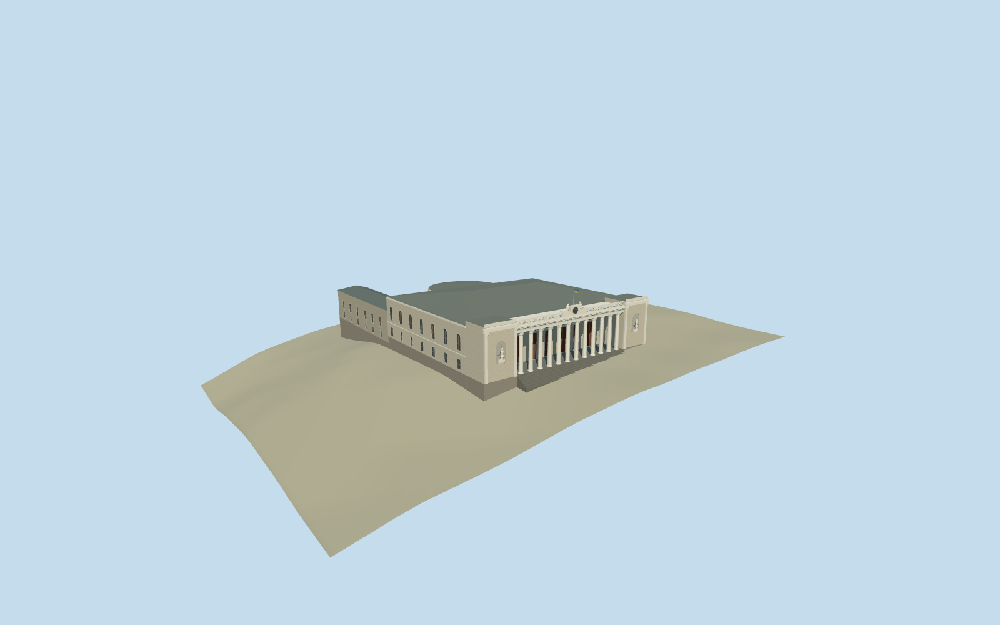

# Odesa City Hall

Odesa’s former Old Stock Exchange with its white Corinthian colonnade, pierced parapet, historic clock and curved rear bay.

Authoring state: **review-in-qa.json**. Current completion evidence is in [qa.json](qa.json) and the [completion ledger](../../../../qualla-structures/batches/qualla-004.PROGRESS.md).

- [Odesa City Hall](https://qualla.com/odesa-city-hall/)

The smaller capitals, statuary, historic clock detail and rear elevations are approximated. The source controls concern the exterior civic monument and its connected ranges.

Build: `node content/worldgen/source/places/u8/u8m/odesa_city_hall/models/generate-odesa-city-hall.mjs`. Add `--check` to verify exact regeneration. 11550 triangles; 5 materials; no embedded photographs.
