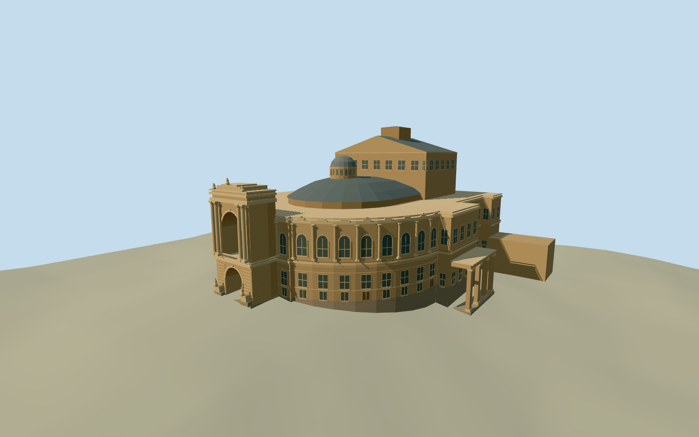

# Odesa Opera and Ballet Theatre

The Odesa Opera and Ballet Theatre with its round sandstone frontage, double-height arched portico, gallery colonnade, and stepped auditorium and stage roofs.

Authoring state: **review-in-qa.json**. Current completion evidence is in [qa.json](qa.json) and the [completion ledger](../../../../qualla-structures/batches/qualla-004.PROGRESS.md).

- [Odesa Opera and Ballet Theatre](https://qualla.com/odesa-opera-and-ballet-theatre/)

Only the building exterior is modeled. Statuary and ornamental profiles will be simplified at catalog scale.

Mapped building parts and roof envelope are combined with an exact original front photograph. Rear openings and profiles without measurements are approximate.

Build: `node content/worldgen/source/places/u8/u8m/odesa_opera_and_ballet_theatre/models/generate-odesa-opera-and-ballet-theatre.mjs`. Add `--check` to verify exact regeneration. 20715 triangles; 6 materials; no embedded photographs.
