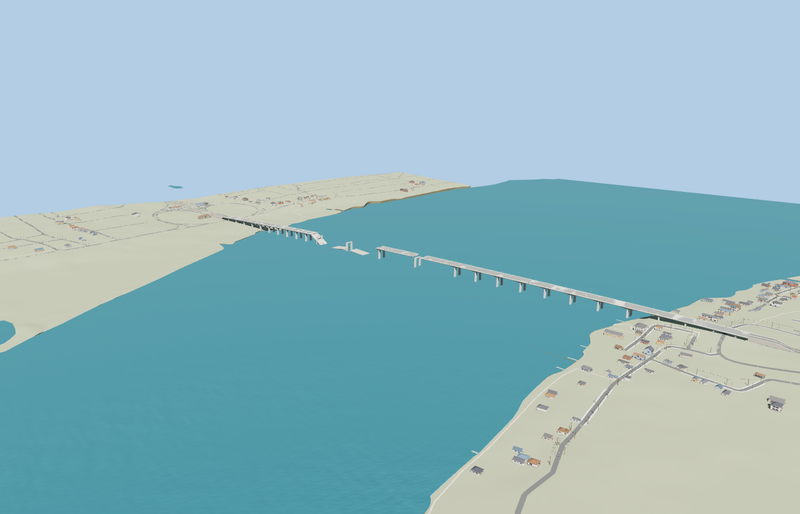

# Antonivka Road Bridge

Reviewed 2026-11-14. The model represents the photographed damage after the November 2022 battle near Kherson. The current viewer places the reconstruction on the mapped Dnipro crossing.

## Geometry and materials

All four levels keep the three surviving deck runs, both major breaks, 26 reconstructed paired-pier groups and large collapsed concrete slabs. Near levels also show the haunched girders, footways, lamps, railings and irregular fracture edges. Shared concrete and painted-metal graphs use metric UVs, and the GLBs contain zero embedded images.

| Level | Triangles | Bytes | Draws |
| --- | ---: | ---: | ---: |
| skyline | 968 | 79,720 | 1 |
| district | 3,940 | 340,784 | 2 |
| street | 14,332 | 1,254,952 | 2 |
| closeup | 32,188 | 2,763,432 | 2 |

The initial skyline and district files total 420,504 bytes. The detailed source retains 99,380 triangles. The browser levels simplify individual rail and lamp hardware. Physical device timings remain pending.

## Placement and verification

The signed model axis runs from Kherson toward the left bank. The three deck runs, 25 m width, and major gaps follow the retained PMTiles footprint. The standard terrain fixture checks four connected native lanes per detail level. The viewer leaves both breaches open and retains 295 buildings, 289 independent road records, the underlying terrain, and the Dnipro surface.

A deliberately failed model load produces identical road records, native approach-support geometry and rendered pixels to the same scene without a landmark. Unloading releases all model and support geometry. The source master, runtime master and four detail levels pass Khronos validation and 608 geometry probes. The review binds the current sources and 67 inspected frames. [Review data](qa.json)

## References and limits

The reference photos establish the historical damaged state. Pier counts, exact breaks, hidden foundations, slumped slab geometry and vertical heights remain visual reconstructions. Temporary barges, nearby military activity and adjacent bank architecture are outside the model scope. [ArmyInform photograph](https://commons.wikimedia.org/wiki/File:Antonivka_Road_Bridge_after_Battle_of_Kherson_(01).jpg) · [November 14 aerial photograph](https://commons.wikimedia.org/wiki/File:Destroyed_Antonivka_Road_Bridge,_Kherson,_2022.11.14_(1).jpg)

The map reference follows OpenStreetMap relation 14890184. Map attribution is © OpenStreetMap contributors under ODbL 1.0. [Map geometry](map-frame.json)
