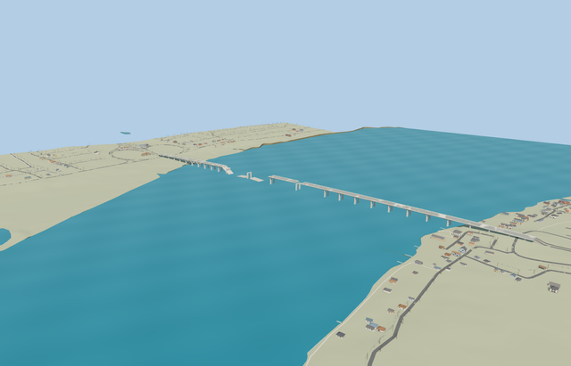

# Antonivka Road Bridge — dated damaged-state model

Reviewed 2026-10-25. **Complete scoped medium-fi exterior and approximate native placement.** This represents the photographed post-November2022 ruins and retained modern multipart map plan. It is not an independently surveyed contemporary damage inventory.

## Geometry and materials

Inspected 66 current frames: 12 portable, 12 shared, 28 medium-fi and 14 native. The dated damaged-state model retains three mapped surviving deck runs, both open breaches, all 26 reconstructed paired portal-pier groups, twin haunched girders, footways, blue/yellow rails and lamp standards, fracture lips and slumped remains. Fixed one large collapsed slab that disappeared in the first skyline; all three large fragments now survive every level. The 100,580-triangle source master and canonical runtime stay separate from browser models. This is an original picture/map reconstruction with explicit approximations, not fabrication geometry or an intact operating crossing.

Two existing 256px shared graphs, concrete_plain and metal_painted, provide metric-repeat concrete/paving grain and painted fittings with restrained component tints. Asphalt uses the shared concrete grain, not a private atlas. No embedded bitmap, photographic pixel or new private texture. Skyline uses one vertex-color draw with shared mean approximation; textured levels use two draws and read each graph once. Separate vertex streams and full model/support disposal pass.

| Level | Triangles | Bytes | Draws |
| --- | ---: | ---: | ---: |
| skyline | 968 | 79720 | 1 |
| district | 3964 | 343952 | 2 |
| street | 14428 | 1266004 | 2 |
| closeup | 32428 | 2792844 | 2 |

Authored skyline/district/street/closeup levels use 968 / 3964 / 14428 / 32428 triangles. Initial skyline plus district is 423672 bytes; closeup is 2792844 bytes. Lower levels retain the full remnant/gap/pier arrangement while reducing small rail posts, lamps, fracture teeth and bars. Noon/late, Economy/High, silhouette and transitions fit the same palette beside procedural neighbors. Physical laptop/phone measurements remain pending.

## Placement and native content

Approximate native fit at [32.720187802,46.67020641], heading -1.517726713957: +X south toward the left bank, -X north to Kherson and the main breaches. The retained exact-QID multipart map plan fixes the three slab extents at scale (1361.549m versus the nominal 1366m length, width25m). Standard 2026-10-20 PMTiles/Mapzen guides fit. River zero, 15.2m bank deck and 24.8m center, pier schedule and debris profiles remain reconstructed. The road mask is inset0.175m per end to retain tiny lane tails and their individual height hints. Four actual native lane joins are within0.082m of the authored deck; no procedural road fills either breach. Coarse approach grades/supports and width transitions remain inferred visualization rather than surveyed road geometry.

Retained all 295 resident / 372 wider native buildings, 289 independent road records, original DEM samples and water/shoreline behavior. Only the original bridge strip and directly connected shore lanes receive replacement/height handling. Unrelated fragments are compared record-wise, including shared feature IDs. Failure retains original native content without new supports; unload releases all model/support geometry and restores ground. Current fixture and engine hashes are pinned. No runtime engine change or repository-wide audit/build was needed for this model.

## Verification

Source generator reproducibility, strict medium-fi, scene validation and 30-tick simulation pass. Six GLBs have zero Khronos errors/warnings; 608 geometry checks and 66 inspected current frames bind the current sources, runtime levels, fixture and engine. After the skyline correction, 58 frames retained exact previously inspected image hashes; changed images were inspected again. Bulk captures stay local; two small summary previews stay with source.

## References and limits

Ordinary [ArmyInform/Commons side photograph](https://commons.wikimedia.org/wiki/File:Antonivka_Road_Bridge_after_Battle_of_Kherson_(01).jpg) and [Vl.Gizycki aerial dated2022-11-14](https://commons.wikimedia.org/wiki/File:Destroyed_Antonivka_Road_Bridge,_Kherson,_2022.11.14_(1).jpg) guided the reconstruction. Reference photos were viewed in the browser and are not redistributed as textures. The major gaps follow [OpenStreetMap relation14890184](https://www.openstreetmap.org/relation/14890184); map attribution is ©OpenStreetMap contributors, ODbL-1.0. Pier count/stationing, exact haunches and damaged faces, hidden foundations, slab slopes, river levels and fittings remain inferred. Ships, barge crossings, military activity, vehicles and bank architecture are outside scope. Physical device timings remain pending.
