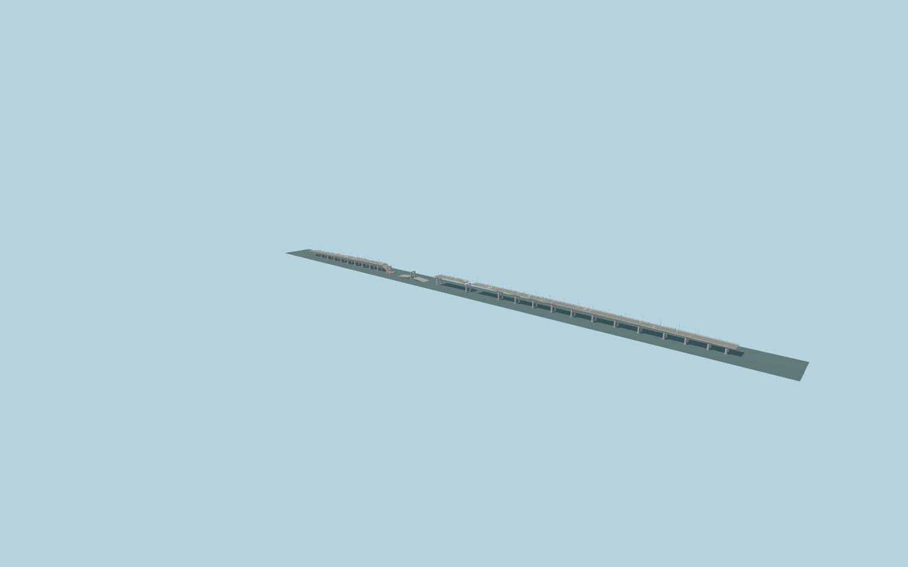

# Antonivka Road Bridge

Dated post-November2022 damaged exterior: three surviving mapped deck runs separated by two breaches, paired tapered portal piers, haunched twin concrete girders, four-lane road/footways, blue-and-yellow railings/lamp standards and slumped fractured spans. Not an intact operating road.

## Evidence

- [Primary reference](https://commons.wikimedia.org/wiki/File:Antonivka_Road_Bridge_after_Battle_of_Kherson_(01).jpg)
- [Primary reference](https://commons.wikimedia.org/wiki/File:Destroyed_Antonivka_Road_Bridge,_Kherson,_2022.11.14_(1).jpg)
- [Primary reference](https://www.openstreetmap.org/relation/14890184)

Published dimensions and reconstruction assumptions are separated in spec.json. Source photos were consulted; no photos or third-party geometry are embedded. Map plan attribution: © OpenStreetMap contributors, ODbL-1.0.

## Source

99380 triangles; 11927600 bytes; 2 material groups. SHA256: sha256:e13d128cbfe5864aa059e5f886749526bb0c109c05a0e54398d5296e0ab4ceda.

Shared surfaces (concrete_plain, metal_painted) are loaded through the central library; any transparent materials use local PBR parameters. Axis and provisional vertical datum are in spec.json.

Regenerate with node packages/worldgen/scripts/generate-researched-bridges.mjs --ids=antonivka_road_bridge; append --check to verify. Import and capture through the standard structure-catalog scripts. Geometry validation does not substitute for current-frame visual review.

## Reconstruction limits

- Dated post-November2022 damaged-state reconstruction, not a current engineering inspection or drivable historical bridge.
- Mapped multipart deck footprints control major gap placement. Individual fracture profiles, hanging bars, underwater debris and damage to hidden pier faces are not surveyed.
- 26 paired-pier groups and their stationing are inferred visual structure, not a verified original span schedule.
- River zero,15.2m bank deck and24.8m central deck are provisional viewer elevations; neighboring approach grades require standard PMTiles/Mapzen review.
- Ships, temporary barge crossings, military activity, vehicles, signs, buried foundations and adjacent bank architecture are outside this asset.
- Shared concrete grain supplies paving/asphalt microvariation with component tints; no bespoke texture, embedded photo or directional lighting is baked into surfaces.
- Physical laptop/phone measurements remain pending. Runtime levels deliberately reduce lamps, rail posts, fracture teeth and exposed bars.
