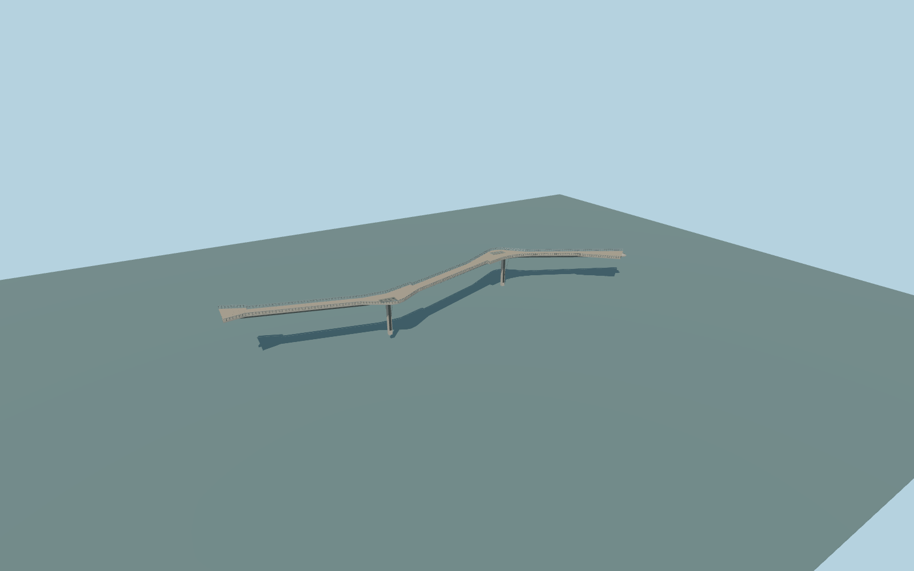

# Bridge over Saint Volodymyr Descent

Three-span bent glass pedestrian/cycle bridge between two hills: widened opposing viewing platforms, real glass floor openings, outward-leaning glass balustrades with kinked metal posts, two mirror-clad rectangular columns and a single tapered spine with cantilever ribs.

Original deterministic source: models/volodymyr-model.mjs, alignment.json and checked-in map/terrain controls. Rebuild with `node packages/worldgen/scripts/generate-volodymyr-bridge.mjs`; append `--check` for exact bytes. Use the standard targeted import and LOD generation commands with `--ids=bridge_over_saint_volodymyr_descent`. GLBs are ignored outputs.

Four existing shared256px surface graphs, clear untextured glass, no private images. Floor inserts are real openings in the opaque deck. Both hilltop ends and two column feet have an approximate fit to the retained standard-viewer native terrain fixture. The lower descent road remains present. See model-brief.json for reconstruction limits and qa.json for actual current acceptance. No surveyed/as-built accuracy or physical-device timing is claimed.

Original geometry uses the repository license. Map controls: © OpenStreetMap contributors, ODbL-1.0;Protomaps basemap. Terrain attribution and raw source hashes are in terrain-grid.json. Linked photographs are references, not redistributed or used as textures.
