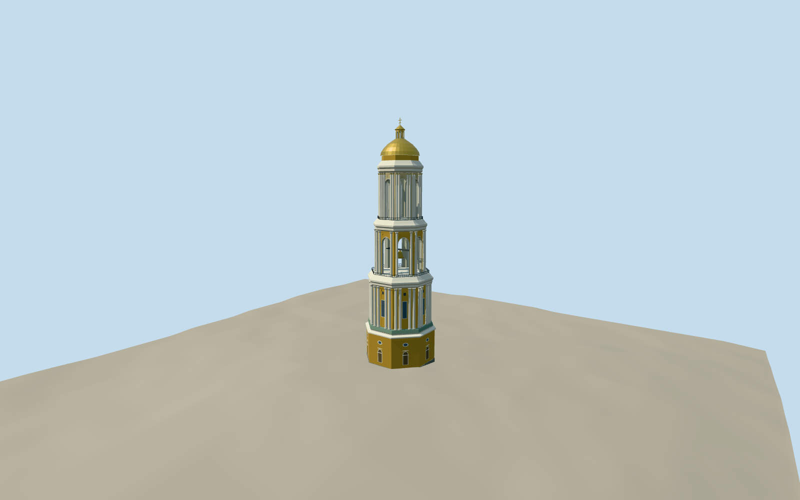

# Great Lavra Bell Tower

Great Lavra Bell Tower in July 2013, with an ochre masonry base, diminishing white colonnades, open belfries, broad cornices and a gilded dome.

Authoring state: **review-in-qa.json**. Current completion evidence is in [qa.json](qa.json) and the [completion ledger](../../../../qualla-structures/batches/qualla-003.PROGRESS.md).

- [Great Lavra Bell Tower](https://qualla.com/great-lavra-bell-tower/)

The total height and base diameter follow the preserve record. Individual tier heights, upper sections, octagon rotation, rear openings and bell positions are estimated from the July 2013 photographs.

Ceramic ornament, eagle reliefs and classical capitals are simplified for medium-fi viewing. The photographed yellow, white, green and gold palette is approximate under different lighting.

The original composite elevation field is preserved. It slopes around the tower plaza, so exposed foundation depth and contact are approximate.

Build: `node content/worldgen/source/places/u8/u8v/great_lavra_bell_tower/models/generate-lavra-belltower.mjs`. Add `--check` to verify exact regeneration. 19648 triangles; 6 materials; no embedded photographs.
