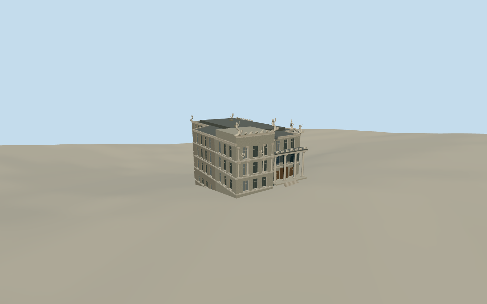

# House with Chimaeras

Kyiv’s House with Chimaeras in 2008, with the Bankova portico, steep downhill wing and sculptural roof.

Authoring state: **review-in-qa.json**. Current completion evidence is in [qa.json](qa.json) and the [completion ledger](../../../../qualla-structures/batches/qualla-003.PROGRESS.md).

- [House with Chimaeras](https://qualla.com/house-with-chimaeras/)

The restored exterior is dated to November 2008. The slope and geographic footprint use original terrain and native geometry.

Roof groups and carvings are modeled with original medium-fi geometry from the documented animal and marine motifs. Individual sculptures are simplified and the hidden sides and exact opening widths are estimated.

The rendered colors use pale cement and gray roof from the documented building materials. The approved photograph uses strong night lighting, so exact daylight tint and roof fixtures are approximate.

Build: `node content/worldgen/source/places/u8/u8v/house_with_chimaeras/models/generate-house-with-chimaeras.mjs`. Add `--check` to verify exact regeneration. 16605 triangles; 5 materials; no embedded photographs.
