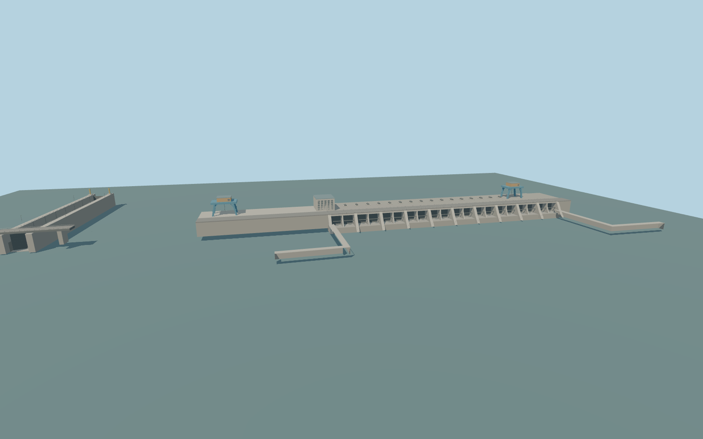

# Kyiv Hydroelectric Power Plant

Kyiv Hydroelectric Power Plant’s 288 m low spillway-powerhouse exterior with paired recessed bays, two blue gantries, control tower, downstream quay walls, navigation lock and road bridge.

Rebuild: `node packages/worldgen/scripts/generate-kyiv-hydroelectric-power-plant.mjs`;append `--check` for exact source bytes. Select import/LOD/placement with `--ids=kyiv_hydroelectric_power_plant`. Detailed source and four browser tiers are separate ignored GLB outputs.

The signed vertical origin is 98.004144 m. The crest road is approximately 107.2 m. The design review uses 103 m headwater, 91.5 m tailwater and 96.1 m illustrative chamber stage.

The published exterior reference dates are August 2018 for the plant and June 2021 for the lock. The model records that appearance, and current repair-era exterior and equipment are unverified.

The crest road, lock and bridge are located from PMTiles. Gate elevations, the low crown grade and some equipment dimensions are exterior approximations.

The standard terrain gives 98.65 m upstream and 90.65 m downstream. The illustrative lock chamber, closed gate configuration and static water are review fixtures. Adjacent dikes and buildings stay native.

Original geometry:repository license. Map:© OpenStreetMap contributors,ODbL-1.0;Protomaps. Standard terrain:terrain-grid.json. Ordinary pictures stay local and are not redistributed or used as textures. Current acceptance:qa.json.
