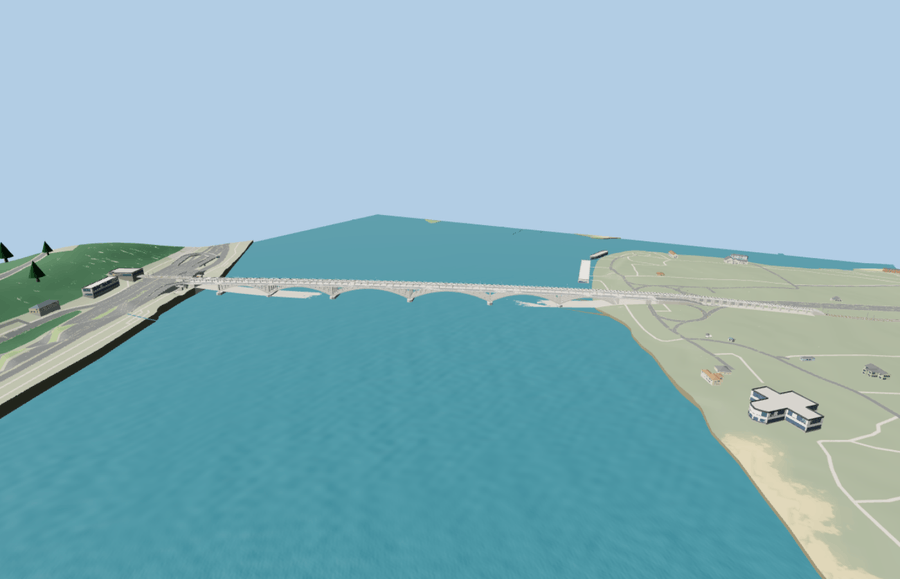

# Kyiv Metro Bridge

Six open arches carry separate road and metro decks, with paired rail tracks continuing around the eastern curve. The street and close-up models retain the arch ribs, spandrels, cutwater piers, barriers and tracks. The detailed master also preserves fine deck fittings, rail detail and the structural hinge assemblies.

The bridge sits over the Dnipro at a 90.65 m datum. Both carriageways meet the mapped road landings. The curved east railway meets both mapped track centerlines. The viewer clips the four bridge features to the covered spans and joins three connected approaches while keeping all 28 other buildings and independent transportation geometry in the fixture.

| Detail level | Triangles | Download bytes | Draws |
| --- | ---: | ---: | ---: |
| skyline | 956 | 72,136 | 3 |
| district | 3,500 | 253,308 | 3 |
| street | 15,676 | 1,120,460 | 6 |
| closeup | 62,404 | 4,848,272 | 6 |

The detailed source rebuild reproduces 499,380 triangles byte for byte. The first two browser tiers total 325,444 bytes. All six GLBs contain zero embedded images.

The review covers 49 captures and 115 placement samples. A failed model load retains the existing road and railway. All four detail levels release their geometry on unload.

The viewer water surface and standard terrain tiles supply approximate elevations. The review samples at the east rail join differ in height by up to 0.44 m across 1.5 m, including sleeper geometry.

The model depicts the permanent exterior and preserves the original detailed source master. Current repair equipment and temporary reinforcement are outside the modeled scope.

[Original crossing photographs](https://mostobud-group.com/projects/mist-metro-dnipro/) · [Municipal repair photographs](https://kyivcity.gov.ua/news/na_mostu_metro_vikonuyut_unikalniy_etap_remontu__vstanovlyuyut_pidtrimuyuchi_arochni_konstruktsi/) · [Terrain and track fit](site-fit.json) · [QA evidence](qa.json)
