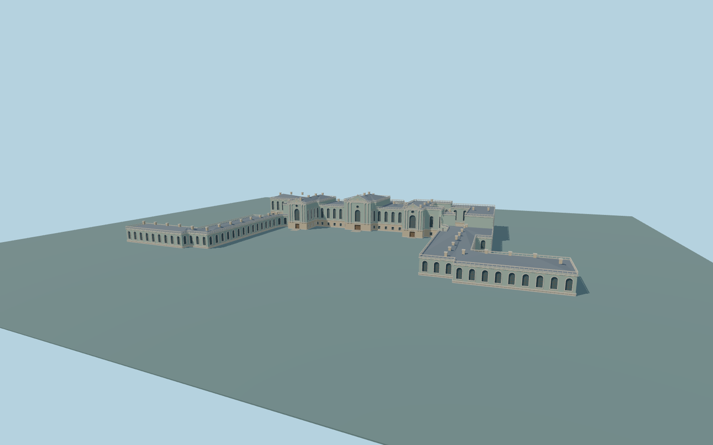

# Mariinskyi Palace

Complete individual Mariinskyi Palace exterior: mint-blue/cream two-story main palace, three projecting raised risalits/crowns, curved rear hall, shallow gray-blue hipped roofs and chimneys, attached low U wings and extended transverse end annexes. Real recessed glazing/closed portals, cream columns and original simplified curved ornament/open roof balustrades. Main forecourt and small rear service court stay roof-free. Independent Rada, administrative buildings, park and fountains remain native. No copied statues, heraldry, inscriptions, event furniture or interiors.

Rebuild: `node packages/worldgen/scripts/generate-mariinskyi-palace.mjs`;append `--check` for exact source bytes. Select import/LOD/placement with `--ids=mariinskyi_palace`. Detailed source and four browser tiers are separate ignored GLB outputs.

Complete individual Mariinskyi Palace exterior: mint-blue/cream two-story main palace, three projecting raised risalits/crowns, curved rear hall, shallow gray-blue hipped roofs and chimneys, attached low U wings and extended transverse end annexes. Real recessed glazing/closed portals, cream columns and original simplified curved ornament/open roof balustrades. Main forecourt and small rear service court stay roof-free. Independent Rada, administrative buildings, park and fountains remain native. No copied statues, heraldry, inscriptions, event furniture or interiors.

Approximate198m standard global Terrarium reference and198.8m palace floor. Main eave10.3m, side-risalit eave12.1m and central-risalit eave13.2m above floor; low wings5.5m. Picture-guided roof/crown proportions and supported bounded entrance transitions, not surveyed historic thresholds. Only occupied palace and three small entry aprons receive ground openings; forecourt/park stay unchanged.

Original medium-fi interpretation of ornate pediments, window/urn inventories, rear elevations, concealed roof joints and historic grades. The native small rear service-court void is retained, without inventing unverified glazing. Main courtyard gardens/fountains and independent city buildings stay outside the model. Physical-device timings and numerical LOD errors remain unmeasured.

Six existing shared256px plaster, limestone, granite, painted metal, painted wood and window-grid graphs; metric UVs and linear colors. Skyline preserves complete native U/extended end annexes, three raised crowns and service-court void. District uses lightweight closed window proxies, street has real recesses, close-up adds columns/mullions/open balustrades/urns, and the source keeps finer curves/frames. Numerical LOD error estimates3/1.5/.7/.25m and physical timings remain unmeasured.

Original geometry:repository license. Map:© OpenStreetMap contributors,ODbL-1.0;Protomaps. Standard terrain:terrain-grid.json. Ordinary pictures stay local and are not redistributed or used as textures. Current acceptance:qa.json.
