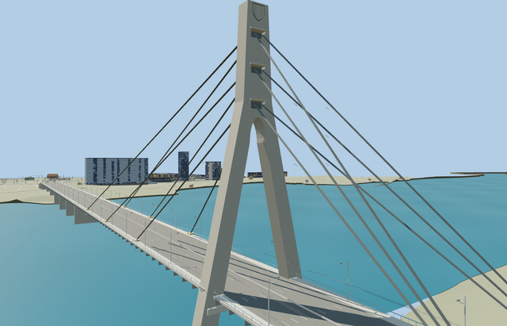

# Pivnichnyi Bridge — completed current pass

Reviewed2026-10-25. **Scoped medium-fi bridge exterior and approximate native placement complete.** The separate Desenka crossing and western overpass remain procedural surroundings.

## Geometry and shared materials

Inspected106 current frames:22 detailed-source,22 shared-material placement,38 medium-fi and24 native. Complete asymmetric eight-span crossing, open A pylon and three anchor galleries, paired three-tier stay planes, six circularly pierced wall piers, twin box girders and soffit, eight-lane road, narrow walks, crescent lamps, near trolley wires, shield rim and Ukrainian nameplates remain. Corrected tube-frame flips and folded lettering in the original draft; moved nameplates outside the pylon face. All browser levels now retain the126m summit mast/flag, avoiding a height jump during upgrades.

Three existing256px shared graphs: concrete_plain, metal_painted and metal_copper. Textured browser roads, concrete and fittings use metric repeats and restrained component tints; no embedded image, private atlas or photo pixels. Each graph reads once; skyline uses one mean-color draw, district/street two draws, closeup three. Separate GPU vertex streams and full disposal pass. The detailed master retains its original palette asphalt/marking treatment alongside the three shared graphs.

| Level | Triangles | Bytes | Draws |
| --- | ---: | ---: | ---: |
| skyline | 928 | 75480 | 1 |
| district | 3856 | 333168 | 2 |
| street | 13364 | 1159196 | 2 |
| closeup | 63420 | 6281608 | 3 |

Preserved a separate1775760-triangle/151461856-byte source master and151461348-byte canonical import. Browser skyline/district/street/closeup use928/3856/13364/63420 triangles and75480/333168/1159196/6281608 bytes. Initial skyline plus district is408648 bytes. Lower levels keep every span, pier opening and paired stay tier while aggregating individual ropes and reducing rail, lamp and hardware repeats. The closeup keeps all crescent lamp stations, bracket loops, nameplate geometry and contact wires. Physical ordinary-laptop and phone/tablet measurements remain pending.

## Placement and native content

Retained directed mapped anchor[30.535911536,50.490673911], heading0.44145746492rad; +X east-northeast to the left-bank pylon. Source789.95m mapped extent and742.81m eight-span structural chain remain distinct from the nominal816m historical extent. Standard PMTiles/Mapzen gives native water90.669792m with provisional source origin83.95m, placing water at sourceY6.719792m. Seven actual road/footway joins meet the modeled deck within0.015m. Explicit replacement outlines remove only the two mapped90m pylon building parts(35185754335597/35185754335598), eliminating duplicate glass towers. Native shore levels, approach widths/grades and hidden foundations remain approximate; no source terrain/water changes or survey accuracy is claimed.

Retained all156 independent resident buildings/269 wider independent buildings and1101 independent road records. Only the two explicitly identified duplicate pylon parts are suppressed while the model is resident. Original map road inputs, raw DEM, native ground and water geometry remain exact. Failure retains all158 original buildings and roads without new supports; unload releases all model/support geometry. Exact per-lane endpoint hints correct selected ground approaches starting just inside the authored outline;58 targeted Earth tests, the affected package typecheck and changed-file Biome checks pass. Earlier full-repository livery-schema failures remain separately recorded.

## Verification

Selected source reproducibility, strict medium-fi, scene validation and30-tick simulation pass. Six GLBs have zero Khronos errors/warnings;204 geometry probes and106 current reviewed frames bind the current source/runtime/LOD/placement/fixture hashes. The final pylon-footprint change kept all six GLB hashes exact, so geometry checks were reused; 82 source/shared/style frames retain their already inspected image hashes. Changed native images were inspected. Bulk evidence remains ignored; two small summary previews remain with source.

## References and reconstruction limits

Two ordinary pylon/span photographs and the retained2021-09-23 Ccangul photograph of the pierced western piers were inspected. See reference-metadata.json, map-frame.json and mapped-features.json; no photo pixels or downloaded meshes are redistributed. Existing2018/2020 engineering notes remain historical inputs without new bespoke research. Published119/125m pylon heights and source foundation/river references have unresolved datum/scope differences. Exact cross sections, individual rope diameters, plate dimensions, buried foundations, current damage/traffic states and shore grades are not surveyed. Physical device timing measurements remain pending.
