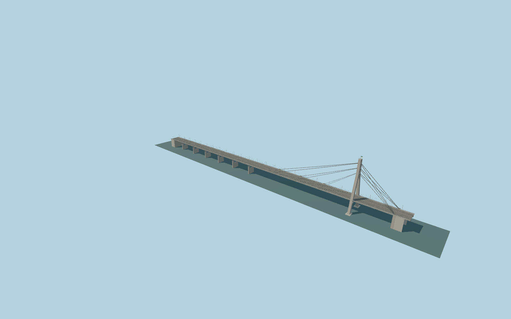

# Pivnichnyi Bridge

Kyiv’s asymmetric Dnipro crossing with an open A pylon, three tiers of individual stay ropes in two planes, eight spans, six circularly pierced wall piers, twin steel box girders, eight road lanes, narrow sidewalks, crescent lamps, trolley wires and current Ukrainian bridge-name plates.

## Evidence

- [Primary reference](https://urdisc.com.ua/media/21-22%272018.pdf)
- [Primary reference](https://urdisc.com.ua/media/Shymanovsky_Narisi_pozaklasnih_mostiv_2020.pdf)
- [Primary reference](https://guide.kyivcity.gov.ua/places/pivnichnyy-mist)
- [Primary reference](https://desn.kyivcity.gov.ua/news/pivnichniy-mist-otrimav-imennu-tablichku)
- [Primary reference](https://commons.wikimedia.org/wiki/Category:Pivnichnyi_Bridge)
- [Primary reference](https://www.openstreetmap.org/way/227851465)

Published dimensions and reconstruction assumptions are separated in spec.json. Source photos were consulted; no photos or third-party geometry are embedded. Map plan attribution: © OpenStreetMap contributors, ODbL-1.0.

## Source

1775760 triangles; 151461856 bytes; 5 material groups. SHA256: sha256:e670b15e93b5622fff5731103321d8648a98781350c964aacbec27028b347355.

Shared surfaces (concrete_plain, metal_painted, metal_copper) are loaded through the central library; any transparent materials use local PBR parameters. Axis and provisional vertical datum are in spec.json.

Regenerate with node packages/worldgen/scripts/generate-researched-bridges.mjs --ids=pivnichnyi_bridge; append --check to verify. Import and capture through the standard structure-catalog scripts. Geometry validation does not substitute for current-frame visual review.

## Reconstruction limits

- Provisional vertical datum and convex road profile require independent terrain and approach review.
- Published816m nominal extent and119/125m pylon heights have unresolved scope/datum differences, preserved in spec.json.
- Pylon cross sections, visible connection details, individual rope diameters and superficial wear are original photographic reconstructions, not fabrication geometry.
- The separate Desenka bridge and western overpass are outside this asset.
- Ordinary photographs guide the current exterior. Historical engineering notes remain retained inputs without new bespoke research. No newly surveyed or contemporaneous2026 damage/traffic state is claimed.
- Browser models aggregate the detailed individual ropes and omit subpixel bolts, tiny cast joints and lettering at lower levels. Physical ordinary-laptop and phone/tablet measurements remain pending.
- Native water is sourceY6.72m rather than the initial6m drafting reference. The source119m concrete/126m mast values and historical119/125m published heights retain their original datum/scope uncertainty. Native approach widths, steep coarse grades and surrounding buildings remain procedural approximations.
- The map encodes the pylon as two90m building parts. Their exact footprints are explicitly replaced by the authored concrete pylon; nearby independent buildings are retained. Coarse shore elevations can obscure buried lower foundations.
