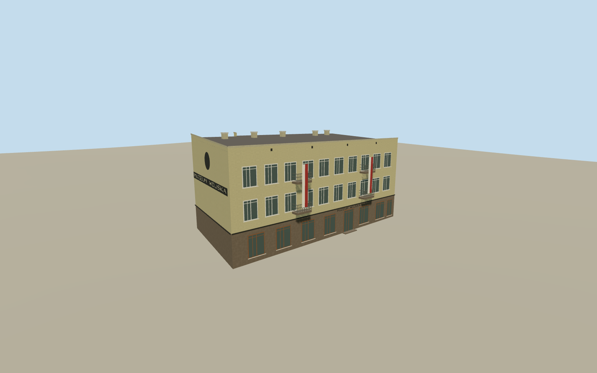

# Army Museum in Białystok

The former Army Museum exterior at 7 Jana Kilińskiego in August 2020, with beige plaster, street windows, projecting balconies, square-facing lettering and monopitch roof.

Authoring state: **review-in-qa.json**. Current completion evidence is in [qa.json](qa.json) and the [completion ledger](../../../../qualla-structures/batches/qualla-003.PROGRESS.md).

- [Army Museum in Białystok](https://qualla.com/army-museum-in-bia-ystok/)

The native outline and two exact 2020 views establish the street building and major window and balcony layout. Roof height, plaque, medallion and obscured rear ground level are simplified estimates.

The original elevation field is unchanged. The model represents the Kilińskiego premises while used as the museum in August 2020. The adjacent address, interiors and later site are outside scope.

Build: `node content/worldgen/source/places/u9/u92/army_museum_in_bia_ystok/models/generate-bialystok-museum.mjs`. Add `--check` to verify exact regeneration. 4452 triangles; 4 materials; no embedded photographs.
