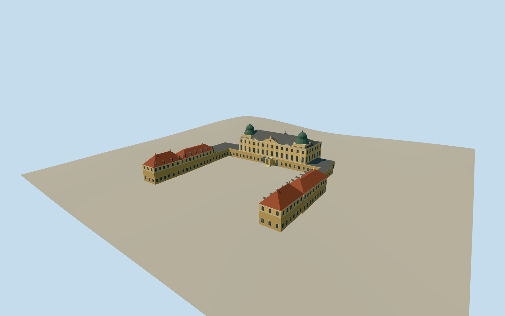

# Branicki Palace, Białystok

The 2023 Branicki Palace exterior in Białystok, with its central baroque residence, clock pediment, green pavilions and attached red-roofed wings around the open forecourt.

Authoring state: **review-in-qa.json**. Current completion evidence is in [qa.json](qa.json) and the [completion ledger](../../../../qualla-structures/batches/qualla-003.PROGRESS.md).

- [Branicki Palace, Białystok](https://qualla.com/branicki-palace-bia-ystok/)

The principal palace and connected wings follow the original native plan. Height, minor roof limits, statues, architectural relief and bay spacing are proportional estimates from the cleared photographs.

The original provider terrain is unchanged. Entry thresholds and local foundations are approximate. The outer gate, formal gardens, boundary structures, and interiors are outside this model.

The summer 2023 permanent exterior uses two Qualla photographs and three independently confirmed CC0 courtyard images by the same photographer.

Build: `node content/worldgen/source/places/u9/u92/branicki_palace_bia_ystok/models/generate-branicki-palace.mjs`. Add `--check` to verify exact regeneration. 8898 triangles; 6 materials; no embedded photographs.
