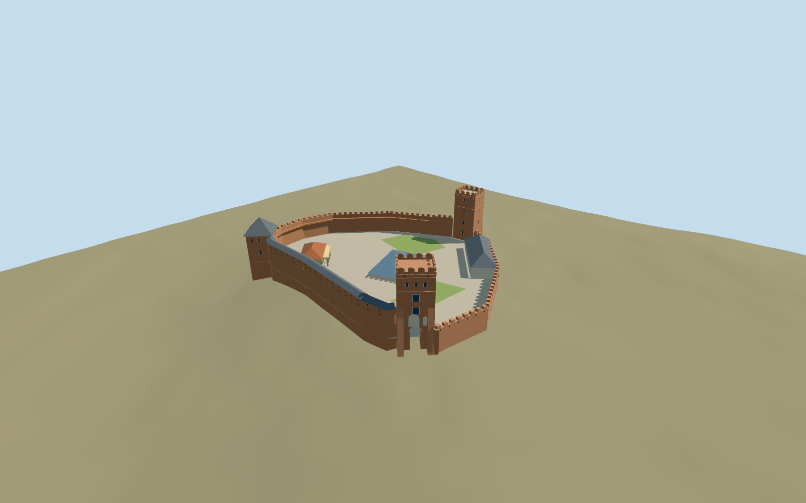

# Lubart's Castle

Lutsk Upper Castle: irregular triangular brick enclosure, west entry tower with buttresses and open round portal, north pyramid-roofed Bishop tower and southeast open-crowned Styr tower; covered timber wall walk, cream noble house, ochre columned book museum and contemporary blue-grey church excavation cover in an open court.

## Evidence and reconstruction

Published dimensions and reconstructed details are separated in spec.json. Primary references:

- [Reference](https://lutskreserve.com/places/verkhniy-lutskyy-zamok)
- [Reference](https://www.visitlutsk.com/luczkij-zamok/)
- [Reference](https://volynrada.gov.ua/map/m-lutsk)
- [Reference](https://tourism.volyn.ua/en/place/1)
- [Reference](https://www.openstreetmap.org/way/633707797)
- [Reference](https://www.openstreetmap.org/way/564453419)

No third-party geometry, photograph or bitmap texture is embedded. Shared surface graphs come from the central library; vertex tints carry model colors. Glazing uses PBR materials; transparent surfaces are declared per model.

## Model and axes

4,497 triangles; 13,491 vertices; 8 material groups; 544,180 bytes. Native bounds: -58.001, -8.483, -52.969 to 60.969, 31.200, 53.113. Source hash: `sha256:d84571ccf618f14c63fef54b3ba29ed83cf876ce1c47b515d1f8f82bfacc70f3`.

{"up":"+Y","longitudinal":"+X northeast,44.4915 degrees north of east","front":"West entry(-X,-Z),north Bishop(+X,-Z),southeast Styr(-X,+Z)","origin":"Site anchor; Y0 standard PMTiles working datum."}

The inspected aerial picture confirms the irregular brick enclosure, open west/Styr crowns, pyramid-capped Bishop tower, covered wall walk and lower museum ranges. Standard viewer PMTiles and the retained compound outline establish location, scale and signed orientation. A reconstructed3.2m level court clears the coarse mound; bounded tower/wall foundations extend beneath sampled ground. Anchor 25.323548196,50.738747737; heading 0.776523631346; standard PMTiles datum 186.99930980801582m. Floors are reconstructed and foundations extend below the coarse sampled ground.

## Reproduce

Run `node packages/worldgen/scripts/generate-signature-towers.mjs --ids=lubarts_castle` (or add `--check`). The generator preserves manually edited masters by checking their baseline hashes. Import through the standard authored-model workflow with optimization disabled; then capture all QA cameras, including shared-surface views.

## Pending work

- Approximate current exterior using inspected picture and standard viewer PMTiles; no bespoke survey or exact threshold research.
- Original detailed architectural master and recipe preserved; independent derivative fits a level working court and bounded foundations.
- Three differently capped towers, buttressed open entry, covered timber walk, open court and contemporary excavation shelter define identity. Heights/openings and crown details reconstructed.
- Upper castle exterior only; lower castle, neighborhood, full natural mound, destroyed palace/church, temporary events and interiors excluded.
- Six shared material graphs and local glass/lawn slots; eight merged groups justified by the mixed campus. Zero embedded images. Physical-device timing pending.

This bundle follows the medium-fi standard. Medium-fi appearance and geographic fit are reviewed separately. Hash-bound visual acceptance is recorded separately after capture inspection.

## Additional geographic data

© OpenStreetMap contributors,ODbL-1.0. State Historical and Cultural Reserve in Lutsk,Lutsk Tourism and Volyn Regional Council primary references.
