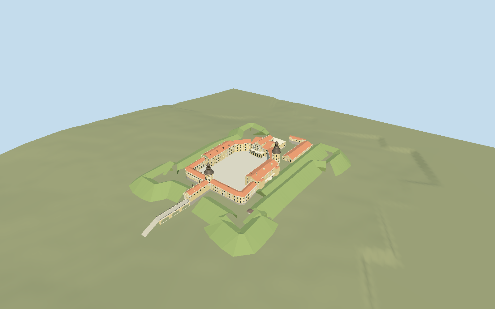

# Nesvizh Castle

Restored ochre palace around its open irregular six-sided courtyard, distinct gate and palace towers with swept metal crowns, red tiled roofs, curved western galleries, ceremonial gate passage, stone arch bridge and grass bastions.

## Evidence and reconstruction

Published dimensions and reconstructed details are separated in spec.json. Primary references:

- [Reference](https://niasvizh.by/en/posetitelyam/dvortsovyy-ansambl/)
- [Reference](https://niasvizh.by/en/history/dvortsovyy_kompleks/)
- [Reference](https://niasvizh.by/upload/bg/dvorec_ekskyrsii_o_myzee.jpg)
- [Reference](https://www.undp.org/belarus/news/sustainable-mobility-helps-tourism-spearhead-green-economy-belarus-regions)
- [Reference](https://whc.unesco.org/en/list/1196/)
- [Reference](https://www.openstreetmap.org/relation/14560856)
- [Reference](https://www.openstreetmap.org/relation/1732915)

No third-party geometry, photograph or bitmap texture is embedded. Shared surface graphs come from the central library; vertex tints carry model colors. Glazing uses PBR materials; transparent surfaces are declared per model.

## Model and axes

34,364 triangles; 76,636 vertices; 7 material groups; 3,175,376 bytes. Native bounds: -130.810, -9.447, -80.232 to 102.953, 35.481, 86.418. Source hash: `sha256:37818a259aa66f8895ecef0e369094c9a4d2da06c0fd832c2c64582c0a4fb3b3`.

{"up":"+Y","longitudinal":"+X 27.188 degrees south of east","front":"West gate and approach bridge toward native -X; +Z south-southwest","origin":"Signed grounds anchor; Y0 decoded187.6694 m working datum."}

Fresh grounds relation14560856 v8 identifies Q719422 and separate palace relation1732915 retains inner court128279266. All148 cached feature vertices match current geometry within0.000070 m. Native +X ESE bearing117.188808 degrees and +Z SSW bearing207.188808 degrees; west bridge/gate at -X and main east palace at +X sign heading -0.47453422597 at [26.691942596,53.222787871]. Museum courtyard and two UNDP2021 exterior photographs actually inspected. Numeric terrain has16641 values on a4 m native grid; decoded anchor datum187.6694 m. Highest occupied ground-level part/court vertex sample plus0.25 m selects floor1.5806 m with rigid -2.4194 m shift. Original broad grounds slab and floating bastion caps removed. Two mapped embankment paths support bounded interpreted earth slopes whose outer toes sample retained ground. Palace/court and side-gallery feet extend below grade. Three true bridge arches retain their open vaults and signed mapped span; west approach fits grade. No ground cut or whole-grounds footprint replacement.

## Reproduce

Run `node packages/worldgen/scripts/generate-signature-towers.mjs --ids=N0254` (or add `--check`). The generator preserves manually edited masters by checking their baseline hashes. Import through the standard authored-model workflow with optimization disabled; then capture all QA cameras, including shared-surface views.

## Pending work

- Original186936-triangle /16074828-byte master remains independently reproducible at sha256:265d4166b08bc10b7bb06532d44d4ff7aba160f03cbc98ea4aa454d389e61f70 from nesvizh-castle-model.mjs#nesvizhStudy.build and unchanged map-parts.json.
- Fresh grounds relation14560856 v8 identifies Q719422 and separate palace relation1732915 retains inner court128279266. All148 cached feature vertices match current geometry within0.000070 m. Native +X ESE bearing117.188808 degrees and +Z SSW bearing207.188808 degrees; west bridge/gate at -X and main east palace at +X sign heading -0.47453422597 at [26.691942596,53.222787871]. Museum courtyard and two UNDP2021 exterior photographs actually inspected. Numeric terrain has16641 values on a4 m native grid; decoded anchor datum187.6694 m. Highest occupied ground-level part/court vertex sample plus0.25 m selects floor1.5806 m with rigid -2.4194 m shift. Original broad grounds slab and floating bastion caps removed. Two mapped embankment paths support bounded interpreted earth slopes whose outer toes sample retained ground. Palace/court and side-gallery feet extend below grade. Three true bridge arches retain their open vaults and signed mapped span; west approach fits grade. No ground cut or whole-grounds footprint replacement.
- Coarse terrain cannot resolve earth-bank crests, bridge arches, building feet or water datum. Pixel ground spacing is a sample interval, not surveyed resolution. Native vertical datum/vintage/under-building contamination remain unverified.
- Palace/court level is highest occupied ground-level mapped part/court vertex sample plus0.25 m; rigid translation preserves relative architectural heights. Mapped rampart paths support bounded interpreted banks with crest4 m above court, a14 m outer slope and7 m inner slope. Their outer toes are sampled from retained ground. No whole-castle ground slab, floating bastion caps or host terrain replacement.
- Bounded structural feet extend four meters below retained ground. Bridge three-arch silhouette follows the mapped driveway; deck remains level at the court and a bounded west approach fits grade. Wider park, moat water and Corpus Christi Church are separate scope. Bank height, widths, historic coats of arms and ornate crowns remain an exterior interpretation, not survey.
- Public terrain contains isolated implausible elevation spikes outside the occupied architecture. The documented8-neighbor20 m outlier filter affects only the retained diagnostic numeric grid; original PNG inputs are unchanged. It is not a terrain survey or a global viewer policy.
- Accepted medium-fi scope is the linked ochre palace around its six-sided roofless court, differing gate/palace swept crowns, red gabled/barrel-dormer roofs, central risalit/pale pilasters/abstract heraldic ornament, curved west galleries, open gate and three-arched stone bridge, two mapped earth-bank paths, pergola and mapped service buildings. Exact figurative sculpture, interiors, park trees, moat water and separate church are outside this asset.
- Five shared graphs provide granite, lime plaster, wood, painted metal and ceramic tile; pale trim shares tinted plaster, bronze/crest details share metal and tower recesses share opaque glass. Grass uses a local color slot. No embedded images or photographed textures. Skyline bakes shared linear material means.
- Bank heights/widths, roof and crown profiles, facade bay counts, ornamental shield, bridge arches and exact civil floor remain interpreted from map/reference photographs, not surveyed. Physical phone/laptop timings pending.

This bundle follows the medium-fi standard. Medium-fi appearance and geographic fit are reviewed separately. Hash-bound visual acceptance is recorded separately after capture inspection.

## Additional geographic data

Map data © OpenStreetMap contributors, ODbL-1.0. Reference photographs were inspected; no third-party photographs or meshes are embedded.
