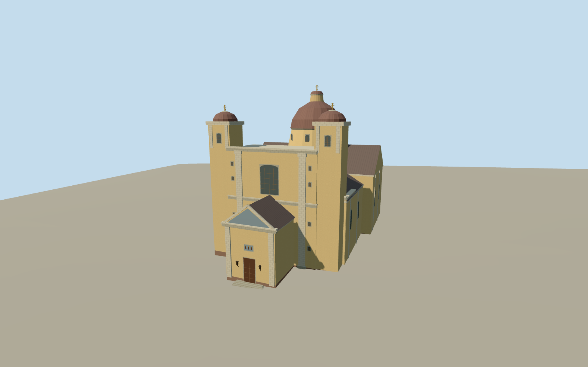

# Orthodox Church of the Holy Spirit, Vilnius

The historic Orthodox monastery church on Aušros Vartų Street, with a low pedimented porch, tall cream pilasters, paired western cupolas and a central dome.

Authoring state: **review-in-qa.json**. Current completion evidence is in [qa.json](qa.json) and the [completion ledger](../../../../qualla-structures/batches/qualla-003.PROGRESS.md).

- [Monastery of the Holy Spirit, Vilnius](https://qualla.com/monastery-of-the-holy-spirit-vilnius/)

This asset covers the principal Orthodox church with its twin west turrets, crossing dome and three apses. The separate bell tower and monastery ranges fall outside this model scope.

The exact 2007 photograph sets the entrance, pilasters, cupola and color. Heights and the side and rear roof details are estimated from the outline and published descriptions. The entrance inscription and icon are simplified.

Build: `node content/worldgen/source/places/u9/u99/monastery_of_the_holy_spirit_vilnius/models/generate-holy-spirit-monastery-vilnius.mjs`. Add `--check` to verify exact regeneration. 3415 triangles; 5 materials; no embedded photographs.
