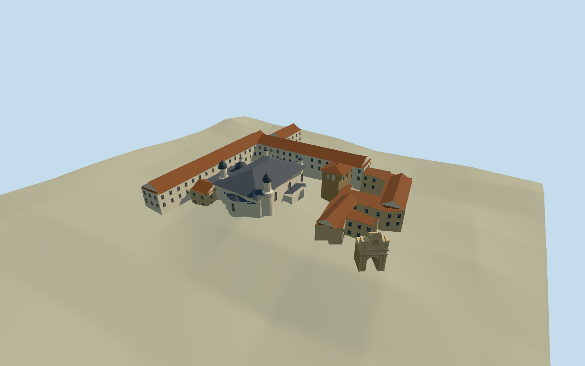

# Monastery of the Holy Trinity, Vilnius

Basilian Holy Trinity monastery in Vilnius, with a four-turret hall church, hipped roof, open Rococo street gate and a separate belfry.

Authoring state: **review-in-qa.json**. Current completion evidence is in [qa.json](qa.json) and the [completion ledger](../../../../qualla-structures/batches/qualla-004.PROGRESS.md).

- [Monastery of the Holy Trinity, Vilnius](https://qualla.com/monastery-of-the-holy-trinity-vilnius/)

Draft exterior: approximate photographic proportions and simplified ornament. It is not a survey, photogrammetric reconstruction or approved current geographic replacement.

The national statutory inventory identifies the hall church, four towers, triple apses and four roof treatments. The cleared ground views show the painted west facade, stone portal, square detached belfry and the layered central street gateway.

Terrain sampling/contact, geographic alignment and site activation remain pending. Runtime LODs are produced by the registered after-import pipeline and require visual review.

Reference photos remain in the local Qualla corpus; only provenance, paths and hashes are retained here.

Build: `node content/worldgen/source/places/u9/u99/monastery_of_the_holy_trinity_vilnius/models/generate-monastery-of-the-holy-trinity-vilnius.mjs`. Add `--check` to verify exact regeneration. 18182 triangles; 5 materials; no embedded photographs.
