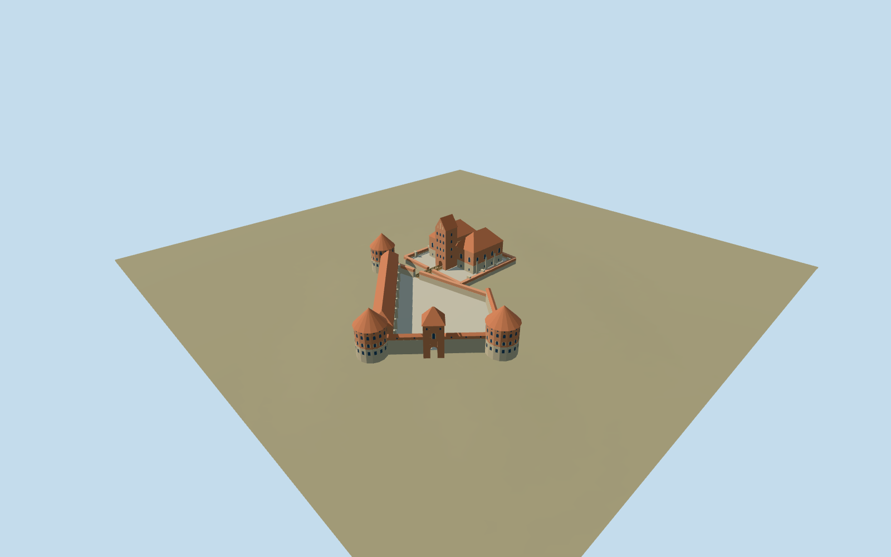

# Trakai Island Castle

Restored Trakai compound with open trapezoidal forecourt,three cone-roof corner towers,arched entry tower,western casemate and separate open-court ducal palace with a tall gabled donjon,short wooden bridge and stone precinct.

## Evidence and reconstruction

Published dimensions and reconstructed details are separated in spec.json. Primary references:

- [Reference](https://trakaimuziejus.lt/en/apie-mus/salos_pilis/)
- [Reference](https://atl.lad.lt/2023/122-129.pdf)
- [Reference](https://www.trakai-visit.lt/en/trakai-island-castle/)
- [Reference](https://www.govilnius.lt/visit-vilnius/places/trakai-castle)
- [Reference](https://www.openstreetmap.org/relation/3111261)

No third-party geometry, photograph or bitmap texture is embedded. Shared surface graphs come from the central library; vertex tints carry model colors. Glazing uses PBR materials; transparent surfaces are declared per model.

## Model and axes

3,386 triangles; 10,158 vertices; 5 material groups; 409,580 bytes. Native bounds: -34.386, -2.155, -24.000 to 88.306, 34.300, 106.973. Source hash: `sha256:c23a599e45316f02ed885efc96bb25d6303f04214547d440b6a68164026e5c97`.

{"up":"+Y","longitudinal":"+Z southwest toward forecourt and approach;palace side wings lie along Z","lateral":"+X southeast across palace wings","origin":"Site anchor; Y0 standard PMTiles working datum."}

The inspected aerial picture confirms the separate palace/gabled donjon, open trapezoidal forecourt, three cone-capped corners, entrance tower and long casemate. Standard viewer PMTiles and the retained palace/courtyard outline establish approximate island location and forecourt approach sign. The mapped relation covers the palace only; whole-compound alignment remains an exterior estimate. A reconstructed1.3m working court clears the coarse island ground and bounded foundations extend beneath samples; short connecting bridge retained at its inferred level. Anchor 24.934056788,54.652709433; heading -1.112277445339; standard PMTiles datum 145.11330053210258m. Floors are reconstructed and foundations extend below the coarse sampled ground.

## Reproduce

Run `node packages/worldgen/scripts/generate-signature-towers.mjs --ids=trakai_island_castle` (or add `--check`). The generator preserves manually edited masters by checking their baseline hashes. Import through the standard authored-model workflow with optimization disabled; then capture all QA cameras, including shared-surface views.

## Pending work

- Approximate current exterior from inspected picture and standard viewer PMTiles; no bespoke survey or exact thresholds.
- Original detailed architectural master/recipe preserved; derivative fits working courts and bounded foundation bottoms.
- Palace/gabled donjon, three red cone roofs, entry passage, open forecourt, casemate, timber gallery and short connecting bridge retain identity. Fine openings and roof/bridge levels reconstructed.
- Mapped relation is palace only; forecourt placement is approximate and footprint replacement remains off.
- Lake/island terrain, long public shore bridge, trees, boats, excavation overlays, temporary structures and interiors excluded.
- Four common material graphs and local opaque glass; zero embedded images. Physical-device timing pending.

This bundle follows the medium-fi standard. Medium-fi appearance and geographic fit are reviewed separately. Hash-bound visual acceptance is recorded separately after capture inspection.

## Additional geographic data

© OpenStreetMap contributors. Trakai History Museum,Lithuanian Archaeological Society/Tautvydas Bajarūnas,Trakai Tourism Information Centre and Go Vilnius.
