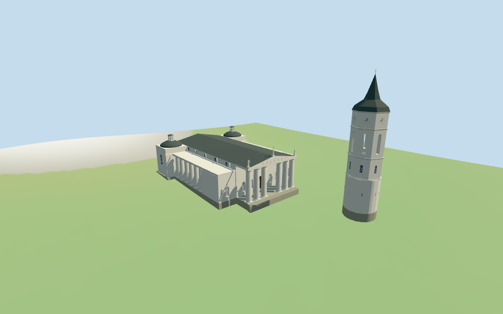

# Vilnius Cathedral

Individual medium-fi cathedral and detached mapped bell tower:six tapered west portico columns with real open bays,recessed closed central door,selected facade niches/figures,triangular pediment and three roof figures/cross,long gray nave roof,open north/south galleries,two rear domed chapels/lanterns,and round-base/faceted bell tower with open belfry,clock fields and dark spire. Exact relief/sculpture,full interiors,adjacent palace,square monuments and certified walking excluded.

## Evidence and reconstruction

Published dimensions and reconstructed details are separated in spec.json. Primary references:

- [Reference](https://madeinvilnius.lt/en/pramogos/renginiai/lauryno-stuokos-guceviciaus-katedrai-220-sukakti-iamzins-vargonu-balsai/)
- [Reference](https://www.alfa.lt/aktualijos/lietuva/vilniaus-arkikatedroje-atidarytas-baroko-perlas-valaviciu-koplycia-nuotraukos/344523/)

Five existing 256-square lime plaster, raw/weathered limestone, standing-seam metal and wood graphs. Metric UVs, linear vertex tints, flat architecture normals and flat glazing. No embedded images.

## Model and axes

16,272 triangles; 48,816 vertices; 6 material groups; 1,956,440 bytes. Native bounds: -78.088, -2.297, -29.983 to 36.890, 61.000, 29.923. Source hash: `sha256:5d0610eeb4bfd6bba20e7649b7affcfd672555baba4533aab6fb60cd0ae81b80`.

{"x":"east toward rear chapels","y":"up","z":"south toward bell-tower side"}

Standard DEM datum 96.258140m;estimated floor 2.0m clears sampled footprint peak 1.632m and perimeter -1.95..1.45m. Foundation follows coarse terrain. Exact plaza/portal thresholds remain approximate;no independent survey or certified walking.

## Reproduce

Run `node packages/worldgen/scripts/generate-additional-landmarks.mjs --ids=vilnius_cathedral` (or add `--check`). The generator preserves manually edited masters by checking their baseline hashes. Import through the standard authored-model workflow with optimization disabled; then capture all QA cameras, including shared-surface views.

## Pending work

- Current cathedral parent is approximately73x60m including lateral galleries/chapels;the detached14.3m bell base sits about70m west and21m south of the cathedral anchor. Current parts give20m main roof/front roof/chapel domes,14m galleries,16m front columns,17m chapel bodies,24m chapel lanterns and25m front cross. Bell parts give15m round base,24m lower faceted stage,36m belfry,50m clock/upper roof control,57m spire and59m finial. Internal stage roles are photo-led estimates:16.8m nave eave,16..17m front entablature,17..20m pediment,17..20m chapel domes and19.8..24m lanterns;bell belfry24..36m,clock stage36..43m,spire43..57m. Column taper,capitals,openings,selected figures/relief fields and thresholds remain approximate;map heights are not a survey.
- Standard DEM datum 96.258140m;estimated floor 2.0m clears sampled footprint peak 1.632m and perimeter -1.95..1.45m. Foundation follows coarse terrain. Exact plaza/portal thresholds remain approximate;no independent survey or certified walking.
- Two useful exterior pictures and standard map/terrain guide this individual medium-fi cathedral/bell exterior. Column taper/capitals,selected figures/relief fields,niches and clocks are simplified. Upper bell uses the approximate mapped faceted plan. Side/rear glazing is selected surface detail;full interiors,exact sculpture/carvings,adjacent palace/square monuments and certified walking excluded. Physical phone/laptop timings pending.
- Skyline preserves six-column open portico,open side galleries,long nave,two domed chapels and detached staged bell tower/spire. District adds shared graphs,closed recessed central door,selected niche fields/figures,frames,flat bell/lantern openings and clocks. Street opens actual belfry/lantern arches and recesses niches;closeup refines columns,curves,mullions and selected figures. Detail changes remain visible.

This bundle follows the medium-fi standard. Medium-fi appearance and geographic fit are reviewed separately. Hash-bound visual acceptance is recorded separately after capture inspection.

## Additional geographic data

©OpenStreetMap contributors;Protomaps;Mapzen/USGS terrain tiles.
