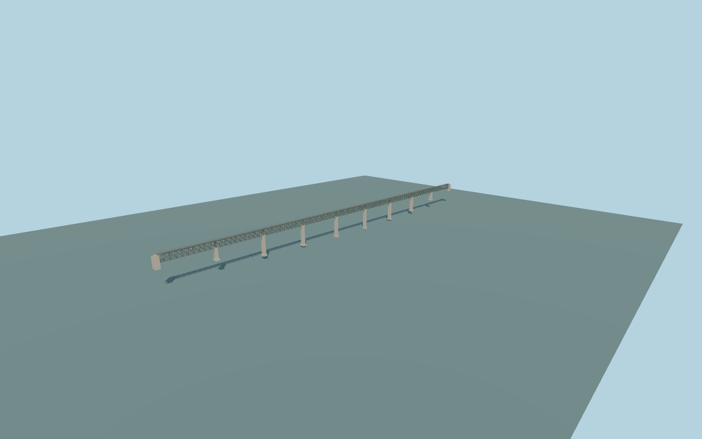

# Lyduvėnai Bridge

Long single-track railway viaduct over the Dubysa valley,with open deep steel X-lattice spans,recessed pale tapered piers,top track and maintenance walks,and the current lower visitor path.

Original deterministic source: models/lyduvenai-model.mjs and attributed map/terrain controls. Rebuild with `node packages/worldgen/scripts/generate-lyduvenai-bridge.mjs`;append `--check` for exact bytes. Import/LOD commands select `--ids=lyduvenai_bridge`. GLBs are ignored outputs.

Three existing shared256px graphs;no private or embedded images. Detailed master and four browser tiers are separate. Native terrain is unmodified. Picture-reconstructed spans,piers,rail datum and bank approach grades remain approximate;the fixture does not certify rail-bed crest elevations. See model-brief.json and qa.json for current scope.

Original geometry uses the repository license. Map controls:© OpenStreetMap contributors,ODbL-1.0;Protomaps. Terrain attribution/raw hashes:terrain-grid.json. Linked reference pictures are not redistributed or used as textures.
