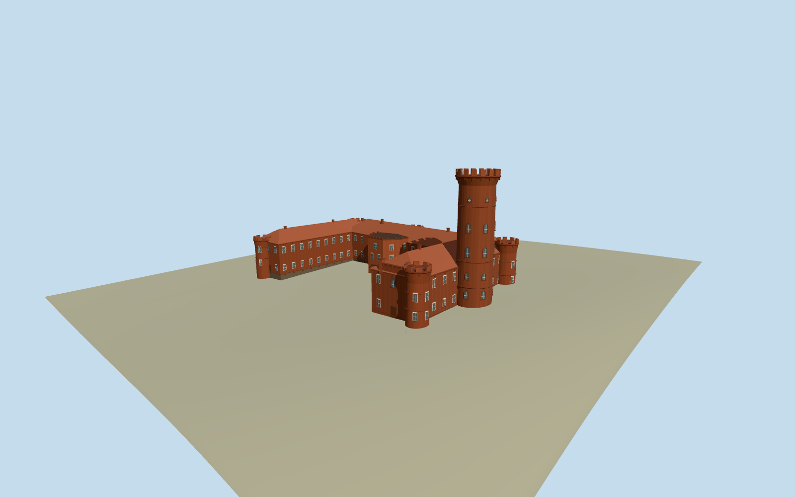

# Raudonė Castle

Raudonė Castle’s three connected brick ranges, west-open court and six round towers, including the tall south observation tower.

Authoring state: **review-in-qa.json**. Current completion evidence is in [qa.json](qa.json) and the [completion ledger](../../../../qualla-structures/batches/qualla-004.PROGRESS.md).

- [Raudonė Castle](https://qualla.com/raudone-castle/)

Minor roof slopes, decorative brick divisions and elevations beyond the two source views are reconstructed at the fidelity appropriate for Earth view.

The model covers the castle proper. The separate granary, mill and estate park are outside its footprint.

Build: `node content/worldgen/source/places/u9/u9b/raudone_castle/models/generate-raudone-castle.mjs`. Add `--check` to verify exact regeneration. 10717 triangles; 7 materials; no embedded photographs.
