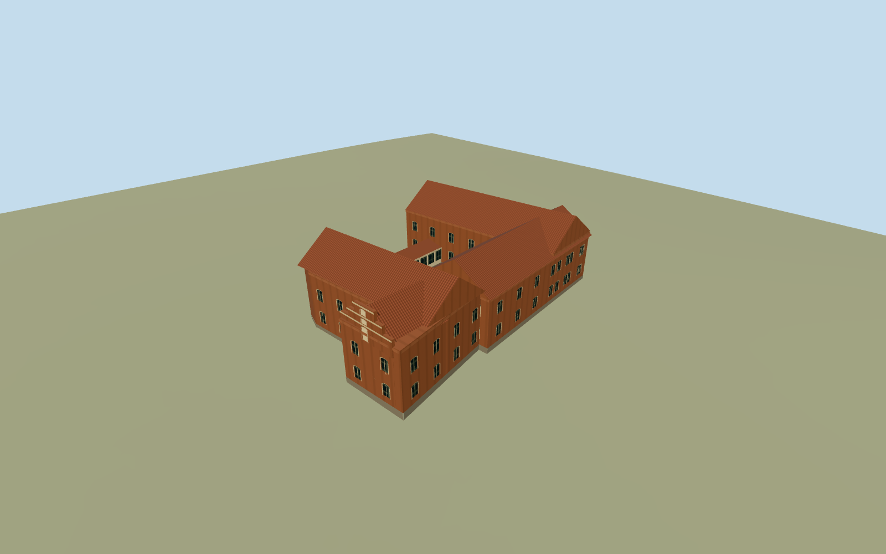

# Tytuvėnai Bernardine Monastery House

Three two-storey brick wings wrap around the smaller cloister court of Tytuvėnai’s Bernardine monastery. A stepped west gable and a low glazed link distinguish the house from the churchyard arcade.

Authoring state: **review-in-qa.json**. Current completion evidence is in [qa.json](qa.json) and the [completion ledger](../../../../qualla-structures/batches/qualla-003.PROGRESS.md).

- [Tytuvėnai Monastery](https://qualla.com/tytuvenai-monastery/)

The official register gives three attached two-storey wings and court dimensions near 16.5 m by 10.8 m. The mapped outline constrains the exterior and the wing roofs are fitted to its courtyard junctions.

The current mortar color, levels and exact fenestration are estimated. The west stepped gable follows the register description.

The preserved terrain shows local grades at regional source resolution. Small threshold elevations are estimated.

Build: `node content/worldgen/source/places/u9/u9b/tytuvenai_bernardine_monastery_house/models/generate-tytuvenai-bernardine-monastery-house.mjs`. Add `--check` to verify exact regeneration. 6591 triangles; 6 materials; no embedded photographs.
