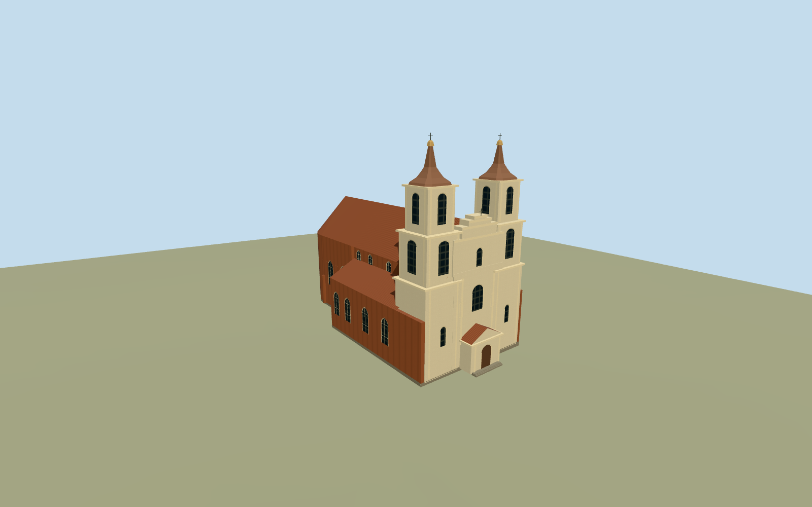

# Tytuvėnai Church of the Blessed Virgin Mary, Queen of Angels

Twin Baroque towers and a white west facade identify the Church of the Blessed Virgin Mary at Tytuvėnai. The high red-tile basilica roof and brick chancel are visible behind them.

Authoring state: **review-in-qa.json**. Current completion evidence is in [qa.json](qa.json) and the [completion ledger](../../../../qualla-structures/batches/qualla-003.PROGRESS.md).

- [Tytuvėnai Monastery](https://qualla.com/tytuvenai-monastery/)

Tower, steep roof and vestibule section heights are visual estimates. Fine cornices, ironwork and carved frontage details are simplified.

The west vestibule is documented in the register and photographed. Its small projection is estimated because it is merged with the mapped west wall.

The preserved terrain shows local grades at regional source resolution. Small threshold elevations are estimated.

Build: `node content/worldgen/source/places/u9/u9b/tytuvenai_church_of_the_virgin_mary/models/generate-tytuvenai-church-of-the-virgin-mary.mjs`. Add `--check` to verify exact regeneration. 2630 triangles; 7 materials; no embedded photographs.
