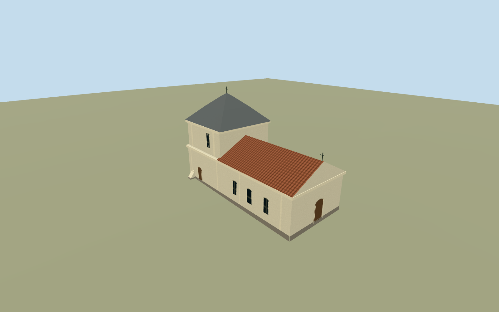

# Tytuvėnai Holy Stairs Chapel

Baroque Holy Stairs Chapel in the Tytuvėnai courtyard, with a white masonry body, tall hipped-roof sanctuary bay and low tiled extension.

Authoring state: **review-in-qa.json**. Current completion evidence is in [qa.json](qa.json) and the [completion ledger](../../../../qualla-structures/batches/qualla-003.PROGRESS.md).

- [Tytuvėnai Monastery](https://qualla.com/tytuvenai-monastery/)

The register gives 17.75 m by 7.45 m. The main shell uses the independently mapped, slightly larger outline.

Tower and window heights, roof finish tone and fine stonework are estimated from the cleared photograph. The interior staircase is outside this exterior scope.

The preserved terrain shows local grades at regional source resolution. Small threshold elevations are estimated.

Build: `node content/worldgen/source/places/u9/u9b/tytuvenai_holy_stairs_chapel/models/generate-tytuvenai-holy-stairs-chapel.mjs`. Add `--check` to verify exact regeneration. 662 triangles; 6 materials; no embedded photographs.
