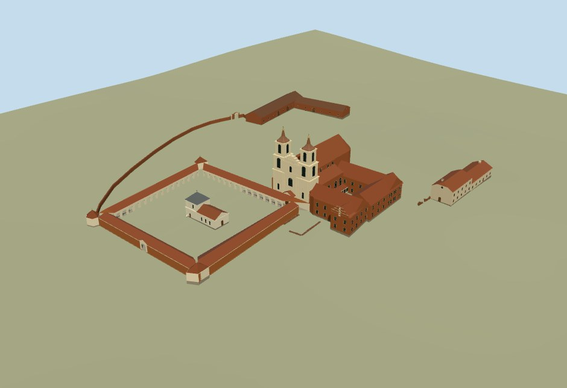

# Tytuvėnai Monastery

The collection brings together 11 independently placed structures and masonry sites at Tytuvėnai. It includes the twin-towered church, Holy Stairs Chapel, courtyard arcade, Bernardine house, granary, servants’ house, two livestock barns, the north wall and gate, and the surviving masonry from the south wall and novitiate.

The assembly preserves the models’ geographic anchors and the original elevation data. The two paired outbuilding footprints are divided using the heritage register and national building maps. Wall routes, ruin heights and fine exterior details are approximate.

[Qualla story](https://qualla.com/tytuvenai-monastery/) · [2026 heritage inventory](https://kvr.kpd.lt/KvrWcf/LabbisServiceKvr.svc/GetDocument/C35D2CF3-6504-45DC-BA95-ABC6BB6CD08E)

Regenerate the assembly with `node content/worldgen/source/places/u9/u9b/tytuvenai_monastery/generate-collection-scene.mjs`. Use `--check` to verify the current assembly.
