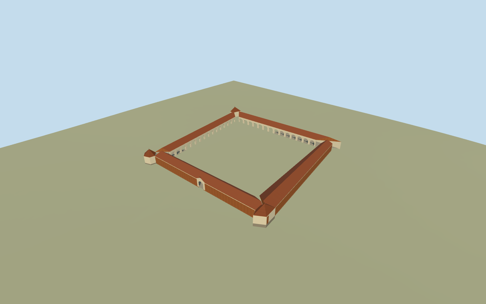

# Tytuvėnai Monastery Arcade Gallery

Four runs of pale inward-facing Baroque arches enclose the Tytuvėnai churchyard. Red clay tile roofs, the west portal and polygonal corner chapels carry the exterior silhouette.

Authoring state: **review-in-qa.json**. Current completion evidence is in [qa.json](qa.json) and the [completion ledger](../../../../qualla-structures/batches/qualla-003.PROGRESS.md).

- [Tytuvėnai Monastery](https://qualla.com/tytuvenai-monastery/)

The mapped relation contains the separate monastery house. This gallery uses the large court’s inner ring and its assigned outer edges.

Individual arcade bays and the west portal approximate the documented arrangement. The third corner chapel plan is an estimate at the surveyed perimeter.

The preserved terrain shows local grades at regional source resolution. Small threshold elevations are estimated.

Build: `node content/worldgen/source/places/u9/u9b/tytuvenai_monastery_arcade_gallery/models/generate-tytuvenai-monastery-arcade-gallery.mjs`. Add `--check` to verify exact regeneration. 5413 triangles; 5 materials; no embedded photographs.
