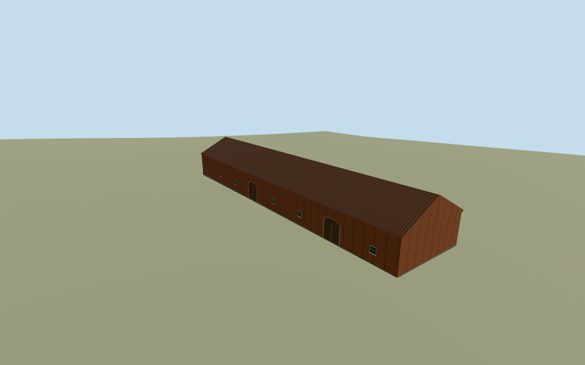

# Tytuvėnai Monastery First Livestock Barn

The historic northern livestock barn at Tytuvėnai, with a long gable roof, brick and masonry walls and prominent arched entrances.

Authoring state: **review-in-qa.json**. Current completion evidence is in [qa.json](qa.json) and the [completion ledger](../../../../qualla-structures/batches/qualla-003.PROGRESS.md).

- [Tytuvėnai Monastery](https://qualla.com/tytuvenai-monastery/)

The northern run is independently identified by the heritage locator. The mapped outer polygon is split at the inset corner between the two connected livestock barns.

Small windows, roof tiles, section height where an eave was unmeasured, and current finish are derived estimates.

The map locates the current exterior. Geometry represents the documented standing volumes. Fine wall or roof repairs and enclosed spaces are outside the exterior scope.

Build: `node content/worldgen/source/places/u9/u9b/tytuvenai_monastery_first_livestock_barn/models/generate-tytuvenai-monastery-first-livestock-barn.mjs`. Add `--check` to verify exact regeneration. 451 triangles; 6 materials; no embedded photographs.
