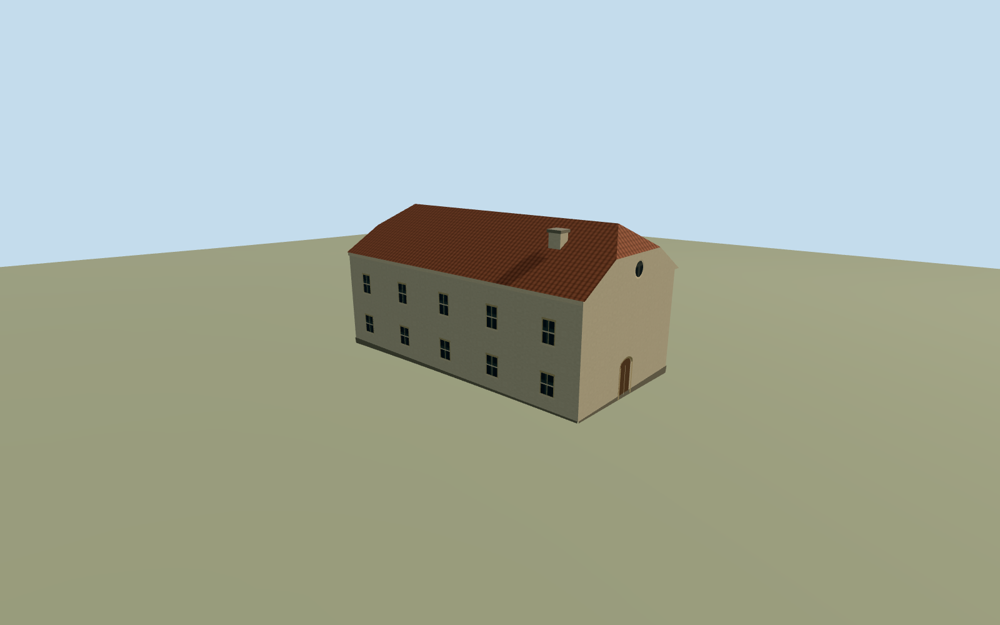

# Tytuvėnai Monastery Granary

Two-storey Tytuvėnai Monastery granary, with a half-hipped tile roof, round gable openings and arched west doorway.

Authoring state: **review-in-qa.json**. Current completion evidence is in [qa.json](qa.json) and the [completion ledger](../../../../qualla-structures/batches/qualla-003.PROGRESS.md).

- [Tytuvėnai Monastery](https://qualla.com/tytuvenai-monastery/)

The register locates the granary in the west part of the contiguous record. Its 20.20 m length fixes the shared boundary with the 24.17 m east servants’ house.

Small windows, roof tiles, section height where an eave was unmeasured, and current finish are derived estimates.

The map locates the current exterior. Geometry represents the documented standing volumes. Fine wall or roof repairs and enclosed spaces are outside the exterior scope.

Build: `node content/worldgen/source/places/u9/u9b/tytuvenai_monastery_granary/models/generate-tytuvenai-monastery-granary.mjs`. Add `--check` to verify exact regeneration. 539 triangles; 5 materials; no embedded photographs.
