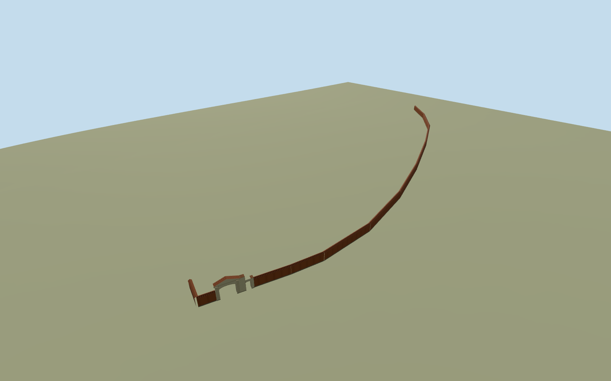

# Tytuvėnai Monastery North Wall and Gate

The curved northern enclosure wall and stepped double gate with adjacent wicket at Tytuvėnai Monastery.

Authoring state: **review-in-qa.json**. Current completion evidence is in [qa.json](qa.json) and the [completion ledger](../../../../qualla-structures/batches/qualla-003.PROGRESS.md).

- [Tytuvėnai Monastery](https://qualla.com/tytuvenai-monastery/)

The national heritage record locates the gate north of the livestock barn. The register describes the wall joining the northwest chapel to the barns. The exact masonry alignment between those controls is estimated.

The wall width, gate proportions, surviving wall heights and exposed masonry limits are approximate.

The geometry represents the accessible standing or exposed fabric described in the register. Original terrain is preserved.

Build: `node content/worldgen/source/places/u9/u9b/tytuvenai_monastery_north_wall_and_gate/models/generate-tytuvenai-monastery-north-wall-and-gate.mjs`. Add `--check` to verify exact regeneration. 512 triangles; 4 materials; no embedded photographs.
