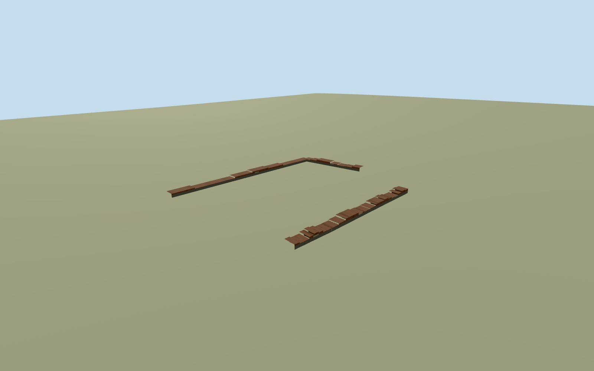

# Tytuvėnai Monastery Novitiate and School Remains

Low exposed traces of the former Tytuvėnai novitiate and school beside the courtyard gallery.

Authoring state: **review-in-qa.json**. Current completion evidence is in [qa.json](qa.json) and the [completion ledger](../../../../qualla-structures/batches/qualla-003.PROGRESS.md).

- [Tytuvėnai Monastery](https://qualla.com/tytuvenai-monastery/)

The national heritage record locates the novitiate adjoining the southern arcade. The written survey documents brick remains on its south side and foundations mostly under sod. The model shows an estimated low visible fragment only.

The wall width, gate proportions, surviving wall heights and exposed masonry limits are approximate.

The geometry represents the accessible standing or exposed fabric described in the register. Original terrain is preserved.

Build: `node content/worldgen/source/places/u9/u9b/tytuvenai_monastery_novitiate_remains/models/generate-tytuvenai-monastery-novitiate-remains.mjs`. Add `--check` to verify exact regeneration. 570 triangles; 3 materials; no embedded photographs.
