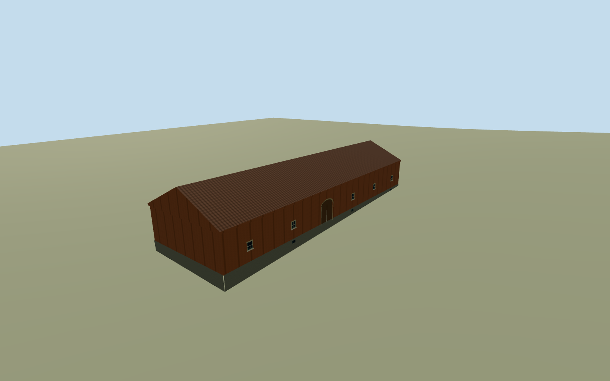

# Tytuvėnai Monastery Second Livestock Barn

The eastern livestock barn at Tytuvėnai, with a plain gable roof, fieldstone base and a partly exposed lower level.

Authoring state: **review-in-qa.json**. Current completion evidence is in [qa.json](qa.json) and the [completion ledger](../../../../qualla-structures/batches/qualla-003.PROGRESS.md).

- [Tytuvėnai Monastery](https://qualla.com/tytuvenai-monastery/)

The eastern leg is identified in the heritage locator. Its country cadastral shape shares a party edge with the northern barn, with outbuilding division set from the inner corner and the survey lengths.

Small windows, roof tiles, section height where an eave was unmeasured, and current finish are derived estimates.

The map locates the current exterior. Geometry represents the documented standing volumes. Fine wall or roof repairs and enclosed spaces are outside the exterior scope.

Build: `node content/worldgen/source/places/u9/u9b/tytuvenai_monastery_second_livestock_barn/models/generate-tytuvenai-monastery-second-livestock-barn.mjs`. Add `--check` to verify exact regeneration. 330 triangles; 6 materials; no embedded photographs.
