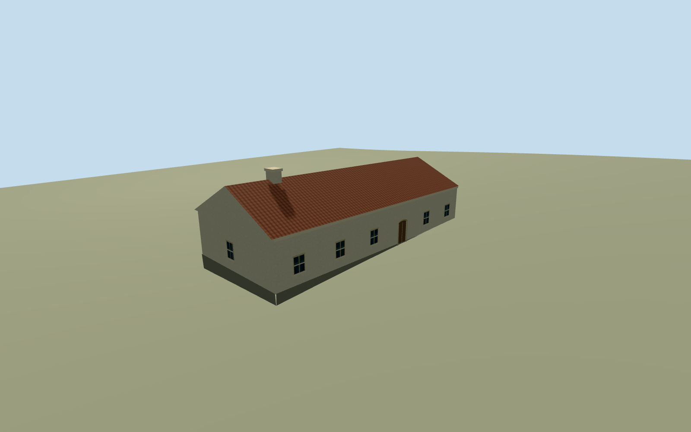

# Tytuvėnai Monastery Servants’ House

Single-storey plastered servants’ house at Tytuvėnai Monastery, with a tile gable and molded chimney.

Authoring state: **review-in-qa.json**. Current completion evidence is in [qa.json](qa.json) and the [completion ledger](../../../../qualla-structures/batches/qualla-003.PROGRESS.md).

- [Tytuvėnai Monastery](https://qualla.com/tytuvenai-monastery/)

The register locates the servants’ house in the east part of the contiguous record. Its survey length is used to partition the exact mapped exterior.

Small windows, roof tiles, section height where an eave was unmeasured, and current finish are derived estimates.

The map locates the current exterior. Geometry represents the documented standing volumes. Fine wall or roof repairs and enclosed spaces are outside the exterior scope.

Build: `node content/worldgen/source/places/u9/u9b/tytuvenai_monastery_servants_house/models/generate-tytuvenai-monastery-servants-house.mjs`. Add `--check` to verify exact regeneration. 338 triangles; 5 materials; no embedded photographs.
