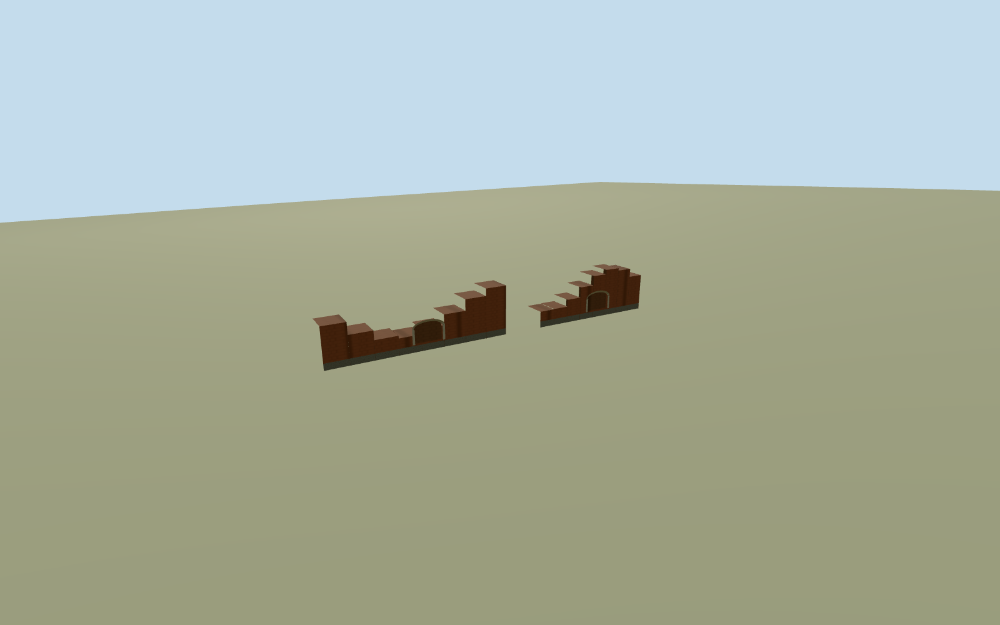

# Tytuvėnai Monastery South Wall Remains

Surviving fragments of a brick enclosure wall and wicket by the Tytuvėnai granary.

Authoring state: **review-in-qa.json**. Current completion evidence is in [qa.json](qa.json) and the [completion ledger](../../../../qualla-structures/batches/qualla-003.PROGRESS.md).

- [Tytuvėnai Monastery](https://qualla.com/tytuvenai-monastery/)

The mapped heritage point lies near the west end of the granary. The written record ties the remnant to the west extension of the granary’s north wall. Break positions and remaining heights are estimated.

The wall width, gate proportions, surviving wall heights and exposed masonry limits are approximate.

The geometry represents the accessible standing or exposed fabric described in the register. Original terrain is preserved.

Build: `node content/worldgen/source/places/u9/u9b/tytuvenai_monastery_south_wall_remains/models/generate-tytuvenai-monastery-south-wall-remains.mjs`. Add `--check` to verify exact regeneration. 330 triangles; 3 materials; no embedded photographs.
