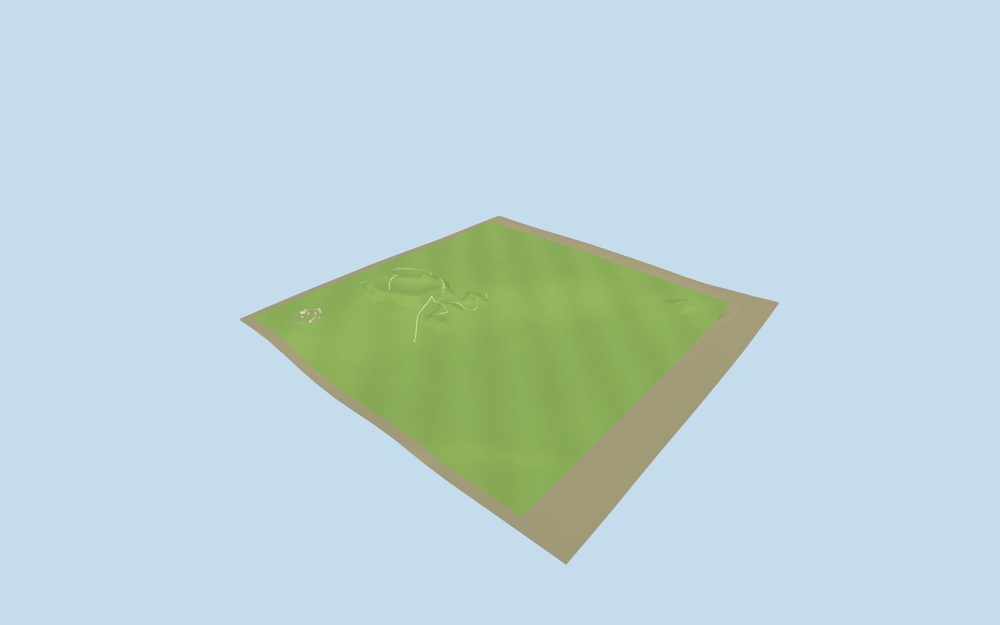

# Kernavė

Approximate PMTiles-fitted Kernave landscape: five separate hillfort earthworks, draped paths/stairs and sloping modern three-yard timber reconstruction with twelve mapped buildings.

## Evidence and reconstruction

Published dimensions and reconstructed details are separated in spec.json. Primary references:

- [Reference](https://whc.unesco.org/en/list/1137/)
- [Reference](https://whc.unesco.org/document/151842)
- [Reference](https://doi.org/10.15388/ArchLit.2019.20.4)
- [Reference](https://www.kernave.lt/ekspozicija-po-atviru-dangumi/)
- [Reference](https://www.openstreetmap.org/node/1690273888)

No third-party geometry, photograph or bitmap texture is embedded. Shared surface graphs come from the central library; vertex tints carry model colors. Glazing uses PBR materials; transparent surfaces are declared per model.

## Model and axes

44,368 triangles; 133,104 vertices; 4 material groups; 5,326,800 bytes. Native bounds: -380.000, -34.927, -280.000 to 500.000, 41.979, 560.000. Source hash: `sha256:644c60e0d9d99d93fb51ae177f25026eb867270298f6051709b71ad0107ca93a`.

{"up":"+Y","longitudinal":"+X east","front":"+Z south","origin":"[24.8517,54.8824], interpreted relative landscape datum"}

Owner-directed picture/standard viewer PMTiles approximate fit. Five separate surviving hillforts retain original horizontal map positions and interpreted crown shapes; native+X east,+Z south, anchor[24.8517,54.8824], heading0. PMTiles supplies low-frequency numeric terrain at this anchor (87.4426m), while authored hillforms add residual relief above the broad PMTiles field, fading to its boundaries. Exact crown elevations remain approximate. The museum now uses sloping PMTiles ground instead of an assumed30m flat terrace; cabins retain level floors and shallow foundations, fences/trails follow approximate ground. A continuous880x840m source surface joins previously separate patches; native ground-cutout metadata prevents underlying viewer terrain covering the reconstruction. Two inspected pictures support surviving knolls and three sloping timber craft yards. No surveyed elevation, precise erosion, certified stair rise or exact terrace level is claimed. No ancient standing fortress or neighboring town buildings are invented.

## Reproduce

Run `node packages/worldgen/scripts/generate-signature-towers.mjs --ids=kernave` (or add `--check`). The generator preserves manually edited masters by checking their baseline hashes. Import through the standard authored-model workflow with optimization disabled; then capture all QA cameras, including shared-surface views.

## Pending work

- Owner-directed picture/standard viewer PMTiles approximate fit. Five separate surviving hillforts retain original horizontal map positions and interpreted crown shapes; native+X east,+Z south, anchor[24.8517,54.8824], heading0. PMTiles supplies low-frequency numeric terrain at this anchor (87.4426m), while authored hillforms add residual relief above the broad PMTiles field, fading to its boundaries. Exact crown elevations remain approximate. The museum now uses sloping PMTiles ground instead of an assumed30m flat terrace; cabins retain level floors and shallow foundations, fences/trails follow approximate ground. A continuous880x840m source surface joins previously separate patches; native ground-cutout metadata prevents underlying viewer terrain covering the reconstruction. Two inspected pictures support surviving knolls and three sloping timber craft yards. No surveyed elevation, precise erosion, certified stair rise or exact terrace level is claimed. No ancient standing fortress or neighboring town buildings are invented.
- Shared timber/gravel graphs plus grass/recess PBR vertex tint, zero copied imagery. Far tiers coarsen continuous terrain and wood detailing; closer tiers restore boards, logs and stairs. Exact hilltop contours and terrain error bounds remain approximate; physical-device timing pending.

This bundle follows the medium-fi standard. Medium-fi appearance and geographic fit are reviewed separately. Hash-bound visual acceptance is recorded separately after capture inspection.

## Additional geographic data

Map geometry © OpenStreetMap contributors, ODbL-1.0. Dimensions summarized from Vengalis & Velius 2019, CC-BY-4.0. Reference photos and LiDAR figure viewed for research only, no image or raster redistribution.
