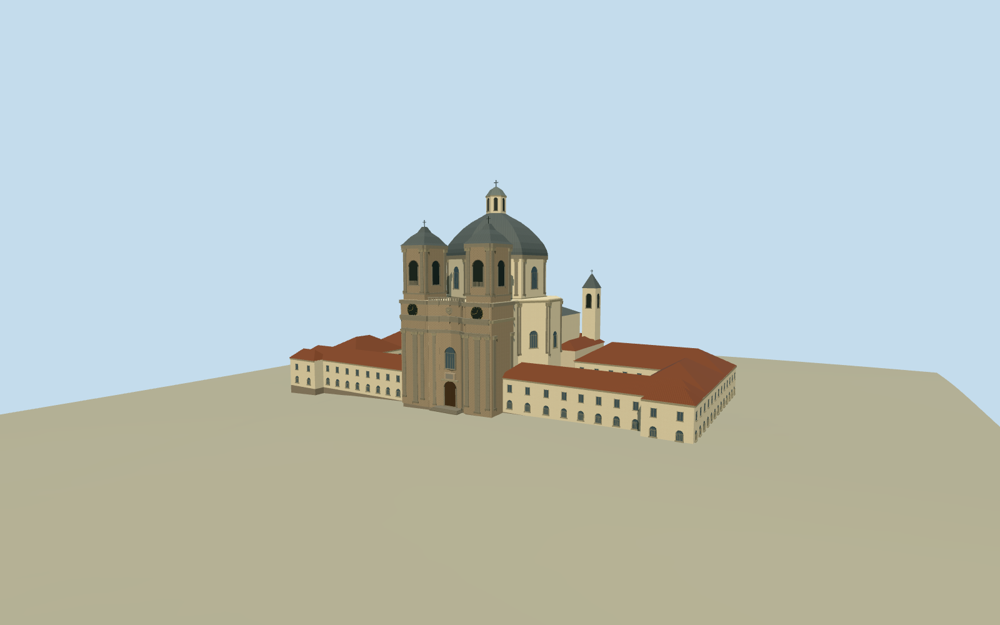

# Pažaislis Monastery

The Baroque church and attached cloister houses at Pažaislis Monastery, with a concave sandstone front, paired clock towers and a hexagonal dome.

Authoring state: **review-in-qa.json**. Current completion evidence is in [qa.json](qa.json) and the [completion ledger](../../../../qualla-structures/batches/qualla-004.PROGRESS.md).

- [Pažaislis Monastery](https://qualla.com/pazaislis-monastery/)

Lower wing elevations and hipped roof subdivisions, the restoration-era dome weathering, individual carvings and ornaments are proportional interpretations. The church interior, detached hermit cells, entrance gate and the separate eastern bell tower are outside the connected-building scope.

Build: `node content/worldgen/source/places/u9/u9c/pazaislis_monastery/models/generate-pazaislis-monastery.mjs`. Add `--check` to verify exact regeneration. 20355 triangles; 8 materials; no embedded photographs.
