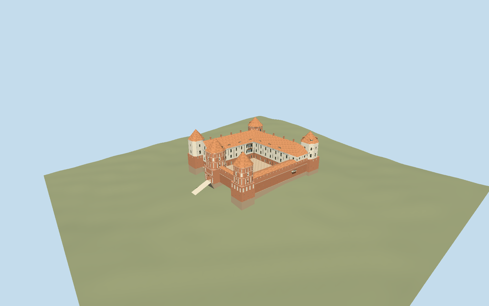

# Mir Castle Complex

Five individually ornamented brick and plaster towers around Mir’s open courtyard, L-shaped residential palace, covered curtain-wall walks, west gate passage and four-arched northern approach bridge.

## Evidence and reconstruction

Published dimensions and reconstructed details are separated in spec.json. Primary references:

- [Reference](https://mirzamak.by/)
- [Reference](https://mirzamak.by/best-photos)
- [Reference](https://whc.unesco.org/en/list/625/)
- [Reference](https://whc.unesco.org/document/169793)
- [Reference](https://www.openstreetmap.org/relation/1579104)

No third-party geometry, photograph or bitmap texture is embedded. Shared surface graphs come from the central library; vertex tints carry model colors. Glazing uses PBR materials; transparent surfaces are declared per model.

## Model and axes

41,975 triangles; 93,435 vertices; 8 material groups; 3,872,036 bytes. Native bounds: -52.000, -9.717, -81.239 to 73.409, 32.125, 38.140. Source hash: `sha256:53fbd7653173288d0f0ab75edc827eb64af374bb6f68a88fd30d94222ccf079f`.

{"up":"+Y","longitudinal":"+X east-southeast, 12.866 degrees south of east","front":"+Z south-southwest; entrance on west/-X","origin":"Retained signed castle anchor; Y0 decoded 175.0822 m numeric working datum."}

Fresh exact-Q209643 relation 1579104 v31 and retained component polygons agree within 0.683 mm. Native +X east-southeast at 102.866 degrees, +Z south-southwest at 192.866 degrees; west gate, differently colored corner towers, north/east palace wings and north bridge sign heading -0.224560956675. Retained Terrarium numeric terrain forms a 4225-value 4 m native grid. Y0 is decoded 175.0822 m anchor working datum, not surveyed regional/ellipsoidal elevation. Reconstructed court floor 0.375 m above anchor uses highest sample inside occupied rectangle plus 0.25 m. One rigid translation preserves relative facade/roof heights. Occupied mapped feet and bridge piers extend four meters below retained grade. Northern path/steps and narrow west gate connector meet retained ground; approach elevations, embankment widths and vertical survey remain approximate. No whole-precinct terrain replacement or cutout.

## Reproduce

Run `node packages/worldgen/scripts/generate-signature-towers.mjs --ids=mir_castle_complex` (or add `--check`). The generator preserves manually edited masters by checking their baseline hashes. Import through the standard authored-model workflow with optimization disabled; then capture all QA cameras, including shared-surface views.

## Pending work

- Original 255892-triangle / 24453976-byte master is independently reproducible at sha256:f309ea5ba68616121c06e1529e32274ebbabb6ae386a14da3e273f40bb32ecee from mir-castle-model.mjs#mirStudy.build.
- Fresh exact-Q209643 relation 1579104 v31 and retained component polygons agree within 0.683 mm. Native +X east-southeast at 102.866 degrees, +Z south-southwest at 192.866 degrees; west gate, differently colored corner towers, north/east palace wings and north bridge sign heading -0.224560956675. Retained Terrarium numeric terrain forms a 4225-value 4 m native grid. Y0 is decoded 175.0822 m anchor working datum, not surveyed regional/ellipsoidal elevation. Reconstructed court floor 0.375 m above anchor uses highest sample inside occupied rectangle plus 0.25 m. One rigid translation preserves relative facade/roof heights. Occupied mapped feet and bridge piers extend four meters below retained grade. Northern path/steps and narrow west gate connector meet retained ground; approach elevations, embankment widths and vertical survey remain approximate. No whole-precinct terrain replacement or cutout.
- Retained coarse terrain does not resolve narrow castle foundations, the northern embankment or paved west forecourt. Numeric source resolution, vertical datum, vintage and under-building contamination are unverified.
- Architectural courtyard floor uses highest sample inside the mapped occupied rectangle plus 0.25 m; one rigid translation preserves relative building proportions. Buried mapped feet and four bridge piers meet this product.
- The narrow northern path/steps and west gate connector are reconstructed civil surfaces tied to mapped lines and retained grade. Their elevations, earth banks and exact width are not a survey; the surrounding park, moat and ramparts remain host terrain.
- ICOMOS 2000 tower heights 22–26 m and mapped roof heights 30/31 m have unresolved roof/datum scope. Body/eave heights of the interpretation and photographed proportions remain explicit rather than presented as measured restoration values.
- Accepted exterior scope is the five-tower castle, open courtyard, L-shaped palace, wall walks, north four-arched bridge and mapped civil connectors. Chapel-crypt, watchman house, palace annex/ruins, park, lake/moat, earth ramparts and massacre memorial of the wider UNESCO complex are separate structures not supplied here.
- Seven canonical graphs provide granite, brick, plaster, timber, ceramic tile, painted metal and rammed earth. Carved and sandstone details share existing slots with component tints. Opaque PBR glass/recess uses no image. Skyline bakes the common linear means. Fine fieldstone placement, facade niches, window/dormer counts and roof curves remain approximations.
- Northern embankment and west forecourt are not resolved by coarse terrain. Narrow mapped civil connections include bounded interpreted earth support, not a measured landscape replacement. Physical phone/laptop timings remain unmeasured.

This bundle follows the medium-fi standard. Medium-fi appearance and geographic fit are reviewed separately. Hash-bound visual acceptance is recorded separately after capture inspection.

## Additional geographic data

Map geometry © OpenStreetMap contributors, ODbL-1.0. Museum photographs and ICOMOS text are research references only; no third-party images or meshes bundled.
