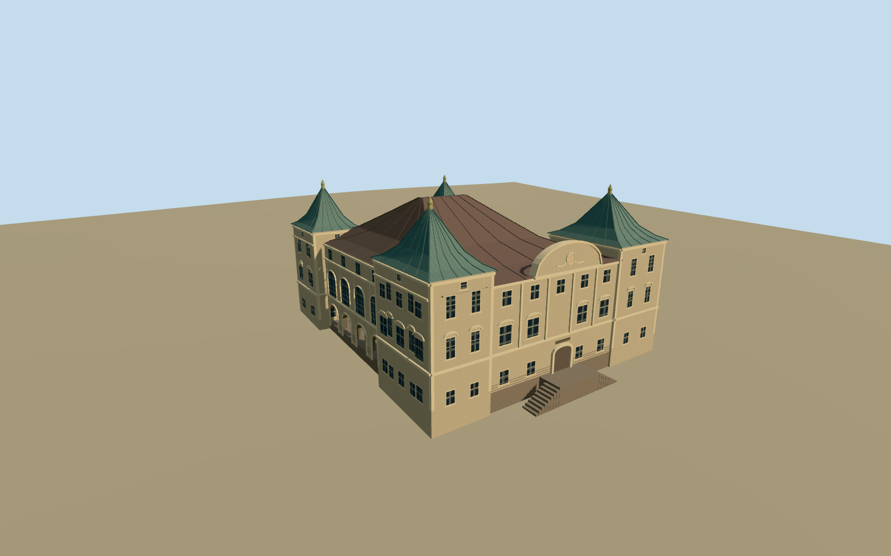

# Sapieha Palace, Vilnius

The restored three-storey Baroque palace in Vilnius, with four concave-roofed corner pavilions, a curved park facade fronton, twin stairs, glazed side galleries and the round eastern addition.

Authoring state: **review-in-qa.json**. Current completion evidence is in [qa.json](qa.json) and the [completion ledger](../../../../qualla-structures/batches/qualla-003.PROGRESS.md).

- [Sapieha Palace, Vilnius](https://qualla.com/sapieha-palace-vilnius/)

The current massing follows the restored late-seventeenth-century architecture and retained eastern addition. The released 2009 image controls surviving openings and wall ornament where they correspond with the final written record.

Exact final paint and roof tones, small sculpture, bay divisions, heights and cornices are approximate. The city park, church, detached gates, courtyard walls and later neighboring hospital wings are outside the model.

Build: `node content/worldgen/source/places/u9/u9d/sapieha_palace_vilnius/models/generate-sapieha-palace-vilnius.mjs`. Add `--check` to verify exact regeneration. 17754 triangles; 8 materials; no embedded photographs.
