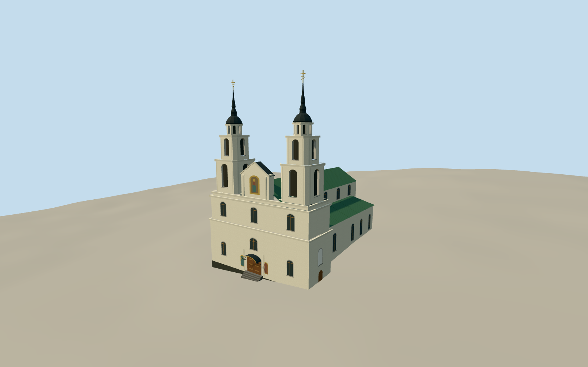

# Holy Spirit Cathedral, Minsk

Holy Spirit Cathedral in Minsk in May 2019, with twin Baroque spires, recessed belfries, white stepped cornices, a green-roofed nave and aisles, and the carved portal canopy.

Authoring state: **review-in-qa.json**. Current completion evidence is in [qa.json](qa.json) and the [completion ledger](../../../../qualla-structures/batches/qualla-003.PROGRESS.md).

- [Holy Spirit Cathedral, Minsk](https://qualla.com/holy-spirit-cathedral-minsk/)

The model depicts the May 2019 cathedral exterior. The adjacent convent and the interior are outside the model scope. Rear fenestration, portal iconography, belfry interiors and the small cross finials are simplified.

Original provider terrain remains unchanged. Local grade and threshold are approximate. Four remote raster outliers near the northwest review edge are retained in the independent source field. They are well outside the building and its entrance.

Build: `node content/worldgen/source/places/u9/u9e/holy_spirit_cathedral_minsk/models/generate-minsk-cathedral.mjs`. Add `--check` to verify exact regeneration. 4490 triangles; 4 materials; no embedded photographs.
