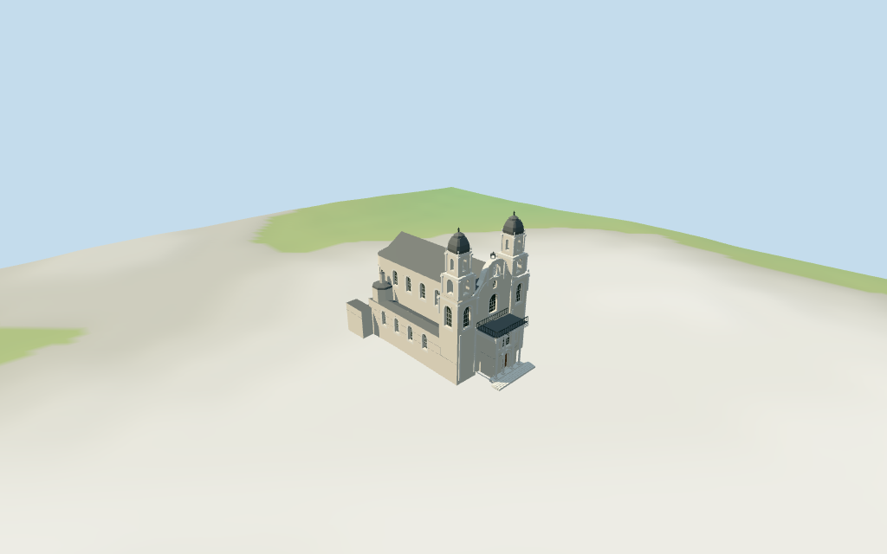

# Cathedral of the Holy Name of Saint Virgin Mary

Individual Minsk Holy Name Cathedral: pale cream plaster/white pilaster Baroque twin-tower front, stacked tall arched fields and hollow upper belfry/attic tiers, dark gray curved metal caps and crosses; shaped central gable with figure niche and small lantern/cross. Projecting entrance with recessed vaulted wood portal, flanking windows, tall central arched glazing, white paired columns, triangular door surround and open balcony railing. Long dark gray nave roof, low aisles, rounded rear apse with geometric windows, two rear-side cupolas/finials and low mapped side ranges. Four existing shared plaster/limestone/standing-seam metal/wood graphs, linear tints, metric UVs, flat normals and four budgeted browser levels. Fine sculptural capitals/urns/statue detail/iron scrollwork/inscriptions, full interiors/bells, exact rear windows/roof joins and surveyed plaza/thresholds remain approximate or excluded.

## Evidence and reconstruction

Published dimensions and reconstructed details are separated in spec.json. Primary references:

- [Reference](https://commons.wikimedia.org/wiki/File:Belarus-Minsk-Archcathedral_of_Name_of_Virgin_Mary-Front-1.jpg)
- [Reference](https://commons.wikimedia.org/wiki/File:Belarus-Minsk-Archcathedral_of_Name_of_Virgin_Mary-Front-2.jpg)
- [Reference](https://commons.wikimedia.org/wiki/File:Archikatedra_Naj%C5%9Bwi%C4%99tszego_Imienia_NMP_w_Mi%C5%84sku_01.jpg)

Four existing cached256-square lime plaster, limestone, standing-seam metal and plain wood graphs. Linear cream/white/gray tints, metric UVs and flat architectural normals. Dark glass/ironwork and sparse accents use geometric PBR colors. No embedded images, unique facade maps or baked shadows.

## Model and axes

16,315 triangles; 48,945 vertices; 6 material groups; 1,961,484 bytes. Native bounds: -23.149, -1.228, -15.315 to 25.200, 35.350, 15.428. Source hash: `sha256:c7038bef1887f2840b88721b3c04234072e3d8ed02e44ec370d95246bbf22e3e`.

{"x":"east/southeast from rounded rear apse toward twin-tower front and projecting entrance","y":"up","z":"south/southwest toward side aisle"}

Standard viewer DEM datum 209.964141m; display floor0.4m, whole perimeter terrain -0.88..-0.00m. Walls extend below coarse viewer terrain, entrance threshold0.3m above model floor with short local steps. Exact Freedom Square/side court grading, threshold/railing joins, absolute altitude and walking remain unverified. No global flattening or road replacement.

## Reproduce

Run `node packages/worldgen/scripts/generate-additional-landmarks.mjs --ids=N0376` (or add `--check`). The generator preserves manually edited masters by checking their baseline hashes. Import through the standard authored-model workflow with optimization disabled; then capture all QA cameras, including shared-surface views.

## Pending work

- Retained exact-QID OSM way482601336/Q1637149 matches current main35184854690168. All25 current whole-outline vertices and78 component plans/tags reproduce by rigid rotation without rescale; retained earlier map details remain separately preserved. Main has no height; numerous component height/min_height values are retained. Front twin towers and rectangular entrance projection are native+X; rounded rear apse is-X. Current principal controls: nave25m, aisles10m, apse/link21m, two tower bases20m, narrower tiers25/30m, caps33/34m, crosses34.95m, shaped central gable21.5/22.85/24.5/26.5m, central lantern27m/cross28m, entrance deck11.5m/balcony elements min11..13m, rear side cupolas14m with small17.5m finials, and low side/rear ranges5/7m. Heights are whole component levels, not increments stacked on previous controls. Estimated internal subdivisions: nave walls20m/gable25m; aisle walls9.3m/hips10m; apse walls18m/faceted roof21m; towers lower windows14..18.5m, middle tier20..25m and upper attic25..30m, curved metal caps30..34m/cross34.95m. Front projection walls11.0m/deck11.5m; upper balcony/columns/rail approximately11.5..13m. Gable profile, vaulted portal depth, pilasters/capitals, figure niche and hidden side/rear fenestration/roof joins are picture/map approximations. No survey or engineering accuracy claimed.
- Standard viewer DEM datum 209.964141m; display floor0.4m, whole perimeter terrain -0.88..-0.00m. Walls extend below coarse viewer terrain, entrance threshold0.3m above model floor with short local steps. Exact Freedom Square/side court grading, threshold/railing joins, absolute altitude and walking remain unverified. No global flattening or road replacement.
- Medium-fi exterior from inspected2018 whole-front and2026 front/tower details plus standard viewer PMTiles/DEM only. Side/rear profiles and windows are inferred from detailed map controls and front architectural character. Fine sculptural capitals/urns/statue detail, text/iron scrollwork, full interior/bells, hidden roof joins and surveyed plaza/thresholds are approximate or excluded. The78 raw component controls include small overlapping decorative plans; their metadata is retained while fine details are simplified rather than mechanically extruded from ground. Physical laptop/phone timing pending.
- Skyline keeps all major massing, tiered towers/caps, shaped gable/lantern, projecting entry, round apse and smaller rear cupolas. District adds shared textures, flat glazing, selected pilasters/urns and open balcony. Street adds real recesses and upper belfry voids, columns, figure niche and finer railing. Closeup/master refine capitals, window bars and nested surrounds. Synthetic cottages are review fixtures.

This bundle follows the medium-fi standard. Medium-fi appearance and geographic fit are reviewed separately. Hash-bound visual acceptance is recorded separately after capture inspection.

## Additional geographic data

©OpenStreetMap contributors; Protomaps; Mapzen/USGS terrain tiles.
