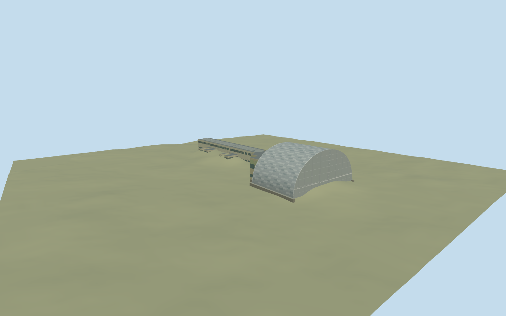

# Chernobyl Nuclear Power Plant

The silver New Safe Confinement arch and the contiguous industrial roofline at the Chernobyl Nuclear Power Plant.

Authoring state: **review-in-qa.json**. Current completion evidence is in [qa.json](qa.json) and the [completion ledger](../../../../qualla-structures/batches/qualla-003.PROGRESS.md).

- [Chernobyl Nuclear Power Plant](https://qualla.com/chernobyl-nuclear-power-plant/)

This is an exterior landmark model. The silver shell follows the plant operator’s published dimensions. The hall cladding, roof joints and smaller visible volumes are approximate.

The 2018 ground photograph shows the installed exterior arch. The model represents its standing roof envelope and simplifies localized subsequent changes to cladding and surface conditions.

The model covers the central standing buildings. The commemorative sculpture, distant construction, canals and separately mapped outlying facilities are outside scope.

Build: `node content/worldgen/source/places/u9/u9j/chernobyl_nuclear_power_plant/models/generate-chernobyl-nuclear-power-plant.mjs`. Add `--check` to verify exact regeneration. 7358 triangles; 6 materials; no embedded photographs.
